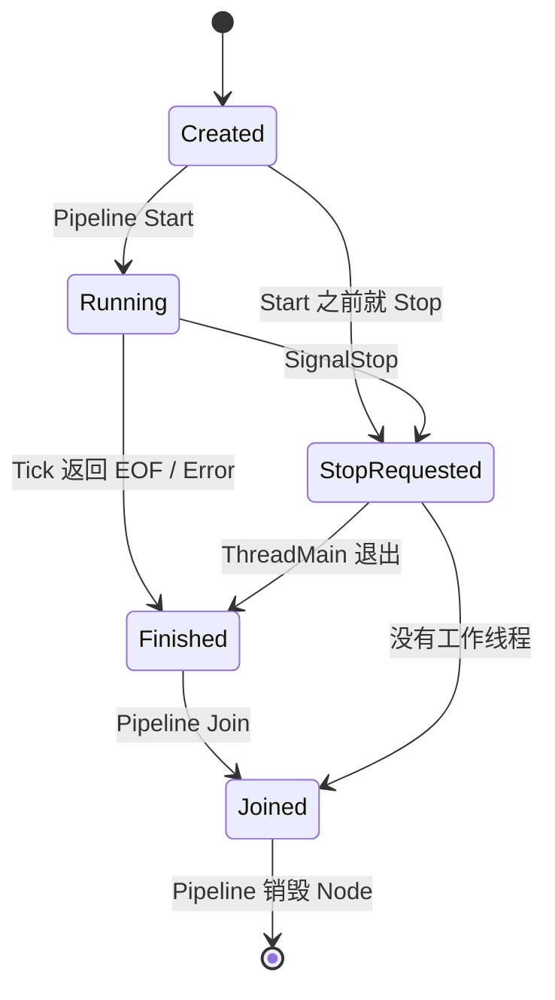
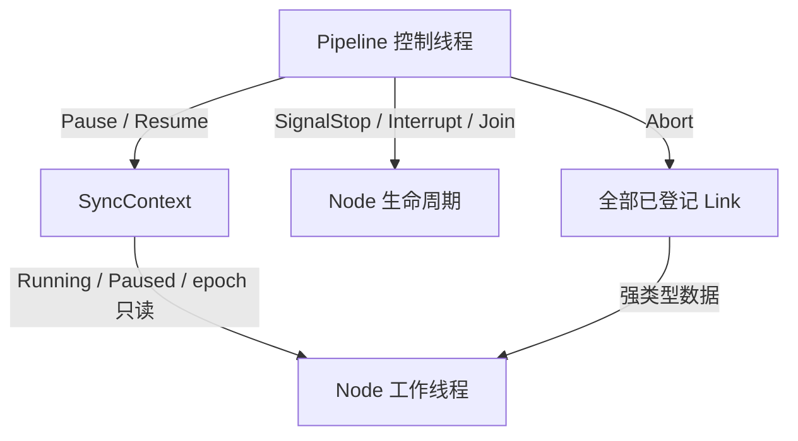

# ARCHITECTURE

> This document describes the implementation currently present in the source tree. Runtime capability depends on the host's display, audio devices, GPU and drivers. For build instructions, see [README.md](./README.md).

本文按当前源码描述播放器与 DAG 的实现。代码路径存在不等于已在每种主机环境验证；尤其 VA-API、DMA-BUF/EGL 导入、可见 OpenGL 显示和真实 ALSA 输出需要相应设备和驱动才能实测。

核心实现位置：

```text
mediacore/src/core/player.cpp                     控制线程、打开任务和媒体 Pipeline 组装
mediacore/src/demux/ffmpeg_demuxer*.cpp           FFmpeg 输入、Demux Node 与 Seek replay
mediacore/src/video_decoder/                     FFmpeg 软件/VA-API 视频解码
mediacore/src/audio_decoder/                     FFmpeg 音频解码、swr、ALSA sink
mediacore/src/av_sync/                           播放时间轴和视频调度
mediacore/src/sink/                              视频/音频输出节点
mediacore/src/core/{pipeline,inode,link,sync_context}.h
app/opengl_view.cpp                              软件纹理和 DMA-BUF/EGLImage 渲染路径
tests/                                           DAG、Demuxer、Player、时间轴等测试
```

## Media Playback

`main()` 创建 `IPlayer`，再把借用指针交给 `PlayerWidget`。Widget 将 `OpenMediaFile()`、Play、Pause、Seek、Stop 转为异步 `IPlayer` 命令；它将 `OpenGLView` 注册为 `IVideoSink`，析构时先 Detach 并等待已进入的回调结束。`IPlayer` 是控制接口，不拥有 UI 或媒体数据。

`Player` 的 `Control` 邮箱线程串行处理应用命令和内部完成事件。每次 Open 会先停止旧 Pipeline 并打断、Join 旧 OpenTask，再创建带递增序号的新 OpenTask。OpenTask 的独立线程负责 FFmpeg 输入打开、流探测和现有轨道的解码器初始化；完成后只投递通知。控制线程检查序号、Join 任务并移动其资源，随后构建 Pipeline。过期 OpenTask 的通知不会启动新的 Pipeline。Player 常规析构会请求退出并 Join 控制线程；若析构发生在工作线程、sink 回调或控制线程自身，则把可 Join 的线程句柄交给 Reaper，避免相互等待。

Pipeline 按媒体实际存在的轨道组图：Demuxer 的压缩视频包连接到 VideoDecoder、AvSync、VideoSink；压缩音频包连接到 AudioDecoder、重采样和 AudioSink。配置决定压缩包与解码帧 Link 的容量，同步后的显示帧 Link 保持一帧。Pipeline 独占 Node，登记全部 Link 和共享 SyncContext；每个 Node 有自己的工作线程。启动顺序反向遍历登记节点，使消费者先于生产者运行。

```text
OpenTask: FFmpeg input/probe + decoder initialization
                         │
                         ▼
DemuxerNode ── StreamItem<Packet> ──┬── VideoDecoderNode ── AvSyncNode ── VideoSinkNode ── IVideoSink
                                    │                                                        │
                                    │                                                        └─ OpenGLView
                                    └── AudioDecoderNode + swr ── PcmFrame ── AudioSinkNode ── ALSA
```

Demuxer 从选中的音视频流读取压缩包，并将各流时间戳按共同时间原点换算到微秒。视频解码输出带时间戳的帧；AvSyncNode 用 `PlaybackTimeline` 中的音频主时钟调度，时钟不可用时回退到单调时钟。VideoSinkNode 在正常播放时交付当前 epoch 的帧，在 Seek 预滚时选择目标附近画面并报告轨道就绪。音频解码器用 FFmpeg send/receive 接口并通过 `swr` 输出 PCM；AudioSinkNode 将 PCM 写入 `IAudioSink`，ALSA 实现负责设备参数、暂停、丢弃旧数据和 drain，并发布播放时钟。

软件视频帧交给 OpenGLView 后通过 CPU 像素数据上传纹理。VA-API 解码是可选路径：`auto` 在 VA 设备/解码器初始化或格式协商阶段失败时用独立的软件上下文回退；强制 VA-API 则报告打开错误。成功创建 VA-API 上下文不等于最终使用硬解，实际模式以解码输出帧格式为准。运行中下载失败会报告错误，不会偷偷重开软件解码器。

硬件帧导出只在渲染端报告能力后尝试。解码线程对当前 VA Surface 执行已有的 `vaSyncSurface()`，然后调用 `vaExportSurfaceHandle(DRM_PRIME_2)`。当前导入转换接受单 layer、双 plane 的 NV12/P010 布局；导出对象的原始 FD 由临时 owner 关闭，dup 后的 FD 和 AVFrame 引用由 `HardwareFrame` 持有。OpenGLView 为每个 plane 创建 EGLImage，将 EGLImage 关联到 Texture。渲染提交后插入 GL Fence，并保留帧对象；Fence 确认完成后，依次释放 Fence、Texture、EGLImage，最后释放 VideoFrame，从而关闭 DMA-BUF FD 并释放 VA Surface 引用。

Context 销毁时，OpenGLView 在可用的当前或 retirement context 中等待并回收待退役帧。Fence 未完成时会把资源批次交给共享 retirement context 的定时回收器；未完成队列会暂停新的硬件帧导出。若 context 丢失、无法建立 retirement context 或回收器分配失败，代码会保留尚不能证明安全的资源到进程退出，避免 GPU 仍在读取时提前关 FD、销毁 EGLImage 或释放 AVFrame。EGL 导入成功也不证明驱动内部没有复制；实际可见显示和零拷贝效果需要目标设备验证。

### Playback Control and Stream End

- **Pause/Resume:** ALSA 硬件支持 pause 时保留设备缓冲；不支持时 sink 使用软件暂停恢复流程。时间轴和 Node 门控仍由控制线程协调。
- **Seek:** Pipeline 递增 epoch、清理旧 Link 项并切换时间轴，再向 Demuxer 提交 Seek。Demuxer 按视频、音频和 replay 阶段定位并发送带新 epoch 的 `StreamReset`。解码器 Flush FFmpeg 状态，音频同时刷新重采样状态并丢弃旧设备 PCM；旧 epoch 数据被拒绝。各活动轨道预滚并报告就绪，Player 按 Seek 前播放意图恢复或保持暂停。
- **Stop:** 控制线程请求停止，Pipeline 先标记所有 Node、Abort 所有 Link、请求打断阻塞 I/O、唤醒暂停 Node，最后 Join 工作线程。OpenTask 的中断请求后仍需 Join 才能释放。
- **EOF:** Demuxer 向活动轨道发送有序 `EndOfStream`。视频和音频解码器排空延迟输出再转发 EOS；VideoSink 标记视频轨结束，AudioSink drain 设备后标记音频轨结束。所有活动轨道结束后 Player 进入 `Ended`。EOS 是流内控制项；Link 的 Close/Abort 用于队列生命周期，不等同于媒体 EOS。

这些是源码的实现行为描述，不替代编码格式、设备输出、画面显示或硬件性能的运行测试。

### Object Ownership and Thread Handoff

```text
main: unique_ptr<IPlayer> -> PlayerWidget (borrowed IPlayer*)
Player: shared Control -> control thread
Control: unique_ptr<OpenTask> / unique_ptr<Pipeline>
Pipeline: unique_ptr<Node> + shared Link<T> + shared SyncContext
OpenTask --Join + Take*--> Demuxer and decoders --move--> Pipeline nodes
```

OpenTask result fields are read only after Join. Decoder and demuxer ownership moves from the task to Pipeline nodes; a Pipeline is stopped and all Node threads are joined before those nodes are destroyed. Display attachment is non-owning and is detached before the widget and OpenGL view are destroyed.

### Link, Backpressure and Epoch

Each Link is a bounded blocking queue. A full queue blocks its producer and propagates backpressure upstream; normal Close allows queued items to drain, while Pipeline Abort wakes blocked senders/receivers and discards queued items during Stop. `StreamItem<T>` carries media values plus `StreamReset` and `EndOfStream` control items in order. The epoch in packets and frames identifies a playback generation: downstream nodes drop old-generation values, while `StreamReset` explicitly flushes codec/device state. Epoch checks do not replace ordered reset processing.

The video path is paced in AvSyncNode using the shared playback timeline and the audio clock when available. Late-frame dropping is controlled by the sync configuration. If the ALSA clock is unavailable, timeline scheduling uses a monotonic clock; the code does not claim sample-accurate synchronization on every device.

### Audio Decode and ALSA Output

`FfmpegAudioDecoderNode` submits compressed packets to FFmpeg, receives decoded audio frames, and uses `swr` to produce the configured interleaved PCM format. `AudioSinkNode` writes PCM through `IAudioSink`; the default `AlsaAudioSink` opens/configures the selected ALSA PCM device, handles partial writes and recoverable ALSA errors, and exposes the consumed audio clock. Pause, StreamReset, Stop and EOS are handled on the sink worker: reset/stop discard stale device data, while normal EOS drains the device before reporting the audio track ended. Device availability and audible output remain runtime properties.

---

## 1. 分层与职责边界

已实现的依赖方向：

```text
Pipeline
  ├── INodeBase / INode<InT, OutT>   Node 线程生命周期与端口
  ├── Link<T>                        强类型数据边
  │     └── ThreadSafeQueue<T>       有界阻塞队列
  └── SyncContext                    运行/暂停门控 + epoch
```

| 类型 | 负责 | 不负责 |
|---|---|---|
| `Pipeline` | 创建并登记 Node/Link，启动、暂停、恢复、停止和 Join 整张图；递增 epoch 并向 Seek source 提交定位 | 解封装、解码等媒体语义由 Node 和 Player 控制层负责 |
| `SyncContext` | 保存全部 Node 共享的 Running/Paused 状态和 epoch，实现暂停等待 | Pipeline 生命周期状态、Node 停止标志、Link 所有权 |
| `INodeBase` | 单个 Node 的一次性线程生命周期、固定 `ThreadMain`、停止标志、退出原因、异常边界 | 完整拓扑、Link 的统一中止 |
| `INode<InT, OutT>` | 零或一个输入端口、零或一个输出端口的强类型连接和收发辅助 | 多输入、多输出拓扑 |
| `Link<T>` | 包装强类型有界队列，提供 Send / Receive / Close / Abort | 决定正常 EOF 或立即停止的时机 |
| `ThreadSafeQueue<T>` | 有界阻塞、背压、Close 排空、Abort 中止 | DAG 类型关系和媒体语义 |

`CreatePlayer()` 当前创建 `Player` 实例。Player 控制线程负责状态转换、打开任务管理、Pipeline 组装及 Seek 协调；Qt 通过 `IPlayer` 使用该实现。

---

## 2. ThreadSafeQueue：背压与两种关闭

`thread_safe_queue.h`。一把 `mutex_` 保护 `queue_`、`closed_`、`aborted_`；两个条件变量 `not_full_cv_` 和 `not_empty_cv_` 分别等待"有空位"和"有数据"。

### 2.1 接口语义

| 操作 | 行为 |
|---|---|
| `Push(T)` | 队列满时阻塞；`closed_` 或 `aborted_` 时返回 false |
| `Pop()` | 队列空时阻塞；`aborted_` 立即返回 `nullopt`；`closed_` 且已排空返回 `nullopt` |
| `Close()` | 置 `closed_`，唤醒两个 CV。之后 Push 失败，Pop 可继续排空 |
| `Abort()` | 置 `aborted_`，唤醒两个 CV，随后 swap 出内部队列丢弃存量 |

### 2.2 三个实现细节

**容量 0 在构造函数直接抛异常。** 容量 0 的有界队列会让 `Push()` 永久等待，没有任何合法用途，所以 `capacity_ == 0` 时抛 `std::invalid_argument`。

**修改共享数据后先 `unlock()` 再 `notify_one()`。** `Push()` 和 `Pop()` 都是这个顺序。如果持锁通知，被唤醒的线程会立刻阻塞在同一把 mutex 上，多一次无谓的上下文切换。

**`Abort()` 先发布状态并通知，最后才清缓存。** 顺序是：加锁置 `aborted_` → 解锁 → `notify_all()` 两个 CV → 再加锁 swap 出队列。这个顺序不能反：如果先清缓存再通知，而清缓存阶段抛异常（元素析构抛异常），等待中的线程就永远醒不过来，`Pipeline::Stop()` 会卡在 Join 上。

### 2.3 Close 与 Abort 的区别

| 操作 | 后续 Send | 已入队数据 | 阻塞线程 | 用途 |
|---|---|---|---|---|
| `Close()` | 失败 | 下游可继续 Receive，排空后得到 `nullopt` | 被唤醒，按排空规则返回 | 正常 EOF |
| `Abort()` | 失败 | 立即丢弃 | Send 和 Receive 都被唤醒并失败 | Pipeline 立即停止 |

两者都是幂等的，且不可恢复。Stop 之后不能复用原 Link，也不能重新 Start 原 Pipeline。

---

## 3. Link：类型擦除与创建权限

`link.h`。`Link<T>` 是 `ThreadSafeQueue<T>` 的语义包装，`Send`/`Receive`/`Close` 直接转发到 `Push`/`Pop`/`Close`。它额外解决两个问题。

### 3.1 类型擦除的控制接口

`Link<int>` 和 `Link<Packet>` 是无关类型，无法放进同一个容器。做法是让 `Link<T>` 继承非模板基类 `ILinkControl`，Pipeline 保存 `vector<shared_ptr<ILinkControl>>`，`Stop()` 遍历调用 `Abort()`，不需要知道具体数据类型。

`ILinkControl::Abort()` 是 **private 纯虚函数 + `friend class Pipeline`**。Node 即使持有 `shared_ptr<Link<T>>` 也调用不到它 —— 立即停止的决定权只在 Pipeline。`Link<T>::Abort()` 同样是 private + `friend class Pipeline`。

### 3.2 创建令牌

`Link` 的构造函数要求传入 `LinkCreationToken`，而 `LinkCreationToken` 的默认构造函数是 private 且只 `friend Pipeline`。效果是**只有 `Pipeline::CreateLink<T>()` 能造出 Link**，任何 Node 想私自 `make_shared<Link<T>>` 都编译不过。

这保证每条 Link 都被登记进 `links_`，Stop 时不会漏掉某条边，导致某个线程永远阻塞在未 Abort 的队列上。

令牌本身有两个 `static_assert` 守着：

```cpp
static_assert(!std::is_aggregate_v<LinkCreationToken>, ...);
static_assert(!std::is_default_constructible_v<LinkCreationToken>, ...);
```

第一条防止 C++17 把它识别为 aggregate 类型 —— 那样 `LinkCreationToken{}` 会绕过访问控制直接聚合初始化。为此令牌显式写了一个 private 的用户提供构造函数。第二条确认默认构造确实不对外可见。

令牌**允许拷贝和移动**，因为它要按值穿过 `std::make_shared` 的可变参数模板传给 `Link` 的构造函数。

### 3.3 方向性

Link 是单向的：上游负责 `Send()` 和正常 `Close()`，下游只负责 `Receive()`。**没有 `CloseInput()`** —— 接收方不能替上游宣布 EOF。

一条 Link 默认连接一个生产者和一个消费者。两个消费者竞争同一队列不是广播，每个数据项只会被其中一个取到。

---

## 4. SyncContext：运行门控与 epoch

`sync_context.h`。一个 Pipeline 一份，通过 `shared_ptr` 注入该图全部 Node。

### 4.1 暂停等待

```cpp
template <typename StopPredicate>
void WaitWhilePaused(StopPredicate should_stop);
```

先做一次无锁快速检查：`state_ != kPaused || should_stop()` 成立就直接返回，正常运行时不会碰锁。否则加 `pause_mutex_`，进入 `pause_cv_.wait(lock, predicate)`。

谓词版本的 `wait` 处理两件事：虚假唤醒，以及"通知先于等待注册"的竞态 —— 加锁后重新检查谓词，如果状态已经变了就不会进入等待。

用模板直接接收谓词而不是 `std::function`，避免每次循环构造一个类型擦除对象。

### 4.2 状态与写入权限

`PipelineRunState` 只有 `kRunning` / `kPaused` 两个值，表示 Node 是否可以开始下一次 `Tick()`。

四个写接口全部是 private + `friend class Pipeline`：

| 函数 | 行为 |
|---|---|
| `SetRunning()` | 持锁写状态，解锁后 `notify_all()` |
| `SetPaused()` | 持锁写状态，不通知（不需要唤醒任何人） |
| `WakeAllPausedThreads()` | 持锁 `notify_all()`，不改状态 |
| `BumpEpoch()` | `fetch_add(1) + 1`，返回新 epoch |

`state_` 是 `atomic<PipelineRunState>`，写入时持 `pause_mutex_`，读取可由 Node 并发无锁执行。持锁写入是为了和 `WaitWhilePaused` 的等待注册串起来，避免检查与等待之间出现空档。

`Pipeline::GetSyncContext()` 返回 `shared_ptr<const SyncContext>`，外部拿到的是 const 视图，加上 private 写接口，双重保证 Node 和 UI 改不了运行状态。

### 4.3 epoch

`epoch_` 是 `atomic<uint64_t>`，初值 0。`INodeBase::IsCurrentEpoch(item_epoch)` 比较 `item_epoch < GetEpoch()`，小于说明是 Seek 之前产生的陈旧数据。

`Pipeline::Seek()` 调用 `BumpEpoch()` 后提交目标位置给 Demuxer seek source。Player 在该同步回调中先将共享时间轴切换到新 epoch，Demuxer 成功定位后通过带内 `StreamReset` 通知下游刷新状态。epoch 用于拒绝旧周期数据；队列不靠 epoch 自动清空，清理由各解码/输出节点按 `StreamReset` 执行。

### 4.4 停止标志为什么不放这里

Node 的停止标志是每个 `INodeBase` 自己的 `atomic<bool> stop_requested_`，不在 `SyncContext` 中。

暂停是可逆的图级状态，停止是不可逆的单节点生命周期终点。合并成一个状态就无法表达"暂停中收到停止请求"这种组合 —— 而 `all.stop_while_paused` 用例恰恰要验证这条路径。

---

## 5. Node 线程协议

`inode.h`，分成两层：`INodeBase` 管线程，`INode<InT, OutT>` 管端口。

### 5.1 状态机



暂停不是 `NodeState`。暂停期间 Node 仍在已启动生命周期内，只是等在 `SyncContext` 的条件变量上。

### 5.2 ThreadMain

`ThreadMain()` 是固定的非虚 private 函数，声明 `noexcept`：

```text
while (true):
    sync_ctx_->WaitWhilePaused([this]{ return IsStopRequested(); })
    if IsStopRequested():   reason = kStopRequested; break
    result = Tick()
    if IsStopRequested():   reason = kStopRequested; break
    if result == kContinue:      continue
    if result == kEndOfStream:   CloseOutputs(); reason = kEndOfStream; break
    if result == kStopped:       reason = kStopRequested; break
    reason = kError; break
catch (...):
    unhandled_exception_ = std::current_exception()
    reason = kUnhandledException
finish_reason_.store(reason)
state_.store(kFinished)
```

**`Tick()` 前后各查一次停止标志。** 前面查，是防止暂停被唤醒后又去处理一轮数据。后面查，是因为 Stop 可能与 `Tick()` 并发：Pipeline 已经 Abort 了 Link，`Receive()` 返回 `nullopt`，Node 的 `Tick()` 会把它当成正常 EOF 返回 `kEndOfStream`。如果不再查一次，一次强制中止就会被记成正常流结束。停止请求的优先级高于 `Tick()` 的业务返回值。

**EOF 分支 `break` 而不是 `continue`。** 关闭输出后再调 `Tick()` 可能空转或重复阻塞。

**`catch (...)` 兜在线程入口。** C++ 异常越过线程边界会直接 `std::terminate()`。这里捕获后存进 `exception_ptr`，Pipeline `Join()` 之后可以读出来。`GetUnhandledException()` 在 Node 未进入 `kJoined` 时抛 `std::logic_error` —— 未 Join 就读 `exception_ptr` 是数据竞争。

`all.tick_exception` 用例覆盖这条路径。

### 5.3 Start / Stop / Join 分离

四个控制函数都是 private + `friend class Pipeline`，具体 Node 无法自己调用。

**`Start(thread_factory)`** 用 CAS 而不是简单赋值：

```cpp
NodeState expected = NodeState::kCreated;
if (!state_.compare_exchange_strong(expected, NodeState::kRunning)) {
    if (expected == NodeState::kStopRequested) return kStopAlreadyRequested;
    return kAlreadyStarted;
}
```

CAS 失败时 `expected` 被写成实际值，据此区分"已经启动过"和"启动前已收到停止请求"。线程工厂抛异常或返回不可 Join 的线程时，状态回滚到 `kCreated`，交给 Pipeline 统一回滚。`all.partial_start_rollback` 用例通过注入一个会失败的线程工厂来验证这条路径。

**`SignalStop()`** 只置标志并用 CAS 循环把状态推到 `kStopRequested`，**不阻塞**。已在 `kStopRequested` / `kFinished` / `kJoined` 的 Node 不再改状态。

**`InterruptBlockingIo()`** 先检查 `thread_.joinable()`，再调派生类的 `OnInterruptBlockingIo()`。

**`Join()`** 区分四种结果：已 Join、没有线程（也记为 `kJoined`，让 Pipeline 用同一套检查）、工作线程试图 Join 自己（拒绝，否则死锁）、`join()` 抛异常。

### 5.4 析构函数不做 Stop / Join

```cpp
virtual ~INodeBase() {
    assert(!thread_.joinable() && "Pipeline must join every Node before destruction");
}
```

只断言，不兜底。如果基类析构里隐式 Join，就会掩盖"Pipeline 漏停了某个 Node"的 bug；而且析构顺序与 Link 生命周期一旦交错，问题极难定位。Debug 构建直接 assert 失败更好。关闭 assert 的构建中，joinable 的 `std::thread` 析构本来就会 `std::terminate()`。

`all.join_before_destruction` 用例验证 Node 析构前状态确实是 `kJoined`。

### 5.5 端口模板

`INode<InT, OutT>` 是模板 + 三个偏特化，用 `NoPort` 空结构体触发：

| 形态 | 特化 | 提供的接口 |
|---|---|---|
| 一进一出 | `INode<InT, OutT>` | `ConnectInput` / `ConnectOutput` / `ReceiveInput` / `SendOutput` |
| 零进一出 | `INode<NoPort, OutT>` | `ConnectOutput` / `SendOutput` |
| 一进零出 | `INode<InT, NoPort>` | `ConnectInput` / `ReceiveInput` |
| 无端口 | `INode<NoPort, NoPort>` | 无 |

用 `NoPort` 而不是 `void`：`Link<void>` 是非法类型，编译器一旦尝试实例化就报错，偏特化能在实例化之前挡掉。

`ConnectInput` / `ConnectOutput` 内部检查 `CanConfigure()`（即 `state_ == kCreated`）并拒绝空指针，运行中改拓扑会返回 false。

`CloseOutputs()` 在 `INodeBase` 中是**纯虚**，四个端口模板各自提供 `final` 实现。多输出 Demuxer 直接继承 `INodeBase`，显式关闭它拥有的活动输出；单端口节点通过端口模板采用统一关闭规则。

多输入或多输出的 Node 直接继承 `INodeBase`，自己持有需要的几条 Link。不为它们发明 `Link<void>` 或可变端口容器。

---

## 6. Pipeline

`pipeline.h`。

### 6.1 持有的对象

```text
Pipeline
  ├── shared_ptr<SyncContext>              构造时创建，注入全部 Node
  ├── vector<unique_ptr<INodeBase>>        独占全部 Node，按登记顺序
  ├── vector<shared_ptr<ILinkControl>>     登记全部 Link，Stop 时统一 Abort
  ├── NodeThreadFactory                    线程创建函数，可注入
  └── PipelineState                        普通枚举，非 atomic
```

`PipelineState`：`kBuilding → kStarting → kRunning → kStopping → kStopped`，一次性，Stop 后不能重新 Start。

### 6.2 为什么 PipelineState 不是 atomic

`CreateLink`、`EmplaceNode`、`Start`、`Pause`、`Resume`、`Stop` 和析构必须由同一个控制线程串行调用。状态枚举和 `nodes_`、`links_`、停止流程共同构成一次完整的状态转换 —— 把一个枚举改成 atomic 并不能让这些复合操作支持并发调用，只会掩盖竞态。

真正需要跨线程读的量才用 atomic：`NodeState`、`stop_requested_`、`finish_reason_`、`PipelineRunState`、`epoch`。

来自 UI 和媒体工作线程的命令/事件先进入 Player 控制线程，再由该线程串行调用 Pipeline。

### 6.3 为什么没有 PipelineState::kPaused

`kRunning` 表示图已启动且尚未停止。图内工作线程当前是跑还是停，由 `SyncContext::PipelineRunState` 表示。因此：

- `Pause()` 成功后 `PipelineState` 仍是 `kRunning`，`PipelineRunState` 变 `kPaused`
- `Resume()` 成功后 `PipelineState` 仍是 `kRunning`，`PipelineRunState` 变 `kRunning`
- 反复 Pause/Resume/Pause 不需要重建 Node 或 Link
- Stop 是一次性生命周期终点，完成后不能重新 Start

`all.pause_resume_pause` 用例覆盖反复暂停恢复。

### 6.4 组图

```cpp
auto link = pipeline.CreateLink<int>(2);

auto& source = pipeline.EmplaceNode<SourceNode>(probe);
auto& sink   = pipeline.EmplaceNode<SinkNode>(probe);

source.ConnectOutput(link);
sink.ConnectInput(link);
```

`CreateLink<T>(capacity)` 有四个 `static_assert`：T 必须是对象类型、不能是数组、不能带 cv 限定、不能是 `NoPort`。然后 `RequireBuilding()` 检查状态，`make_shared<Link<T>>(capacity, LinkCreationToken{})` 创建并登记到 `links_`。

`EmplaceNode<NodeT>(args...)` 自动注入 SyncContext，实际构造 `NodeT(sync_ctx_, args...)`，调用者只传 Node 自己的参数。四个 `static_assert`：必须继承 `INodeBase`、必须公开且无歧义继承、不能是抽象类、必须能用 `(shared_ptr<SyncContext>, Args...)` 构造。

返回的引用为什么有效：Node 本体由 `make_unique` 分配在稳定的动态存储上，`vector` 扩容移动的是 `unique_ptr` 而非 Node 对象。引用只用于组图或查询，不拥有 Node，不能越过 Pipeline 生命周期。

### 6.5 Start

前置条件：状态是 `kBuilding`、至少一个 Node、Node 按 Source → Sink 登记、端口已连接。

```cpp
for (auto it = nodes_.rbegin(); it != nodes_.rend(); ++it) {
    if ((*it)->Start(thread_factory_) != NodeStartResult::kStarted) {
        return Stop() ? kNodeStartFailed : kRollbackFailed;
    }
}
```

**反向遍历，消费者先启动。** 如果生产者先跑起来而消费者还没启动，数据会堆到队列满、生产者阻塞在 `Send()` 上；虽然最终能恢复，但启动阶段行为不确定。

任一 Node 启动失败立即调完整 `Stop()` 回滚已启动的线程。

**当前 Pipeline 不分析 Link 连接关系，也不做拓扑排序。** 登记顺序错了框架不会自动发现。`all.consumer_starts_first` 用例验证实际启动顺序是 Sink 先于 Source。

### 6.6 Stop 的五个阶段

```text
1. SignalStop(每个 Node)           让全图先看见停止请求，包括还没建线程的 Node
2. Abort(每条已登记 Link)          唤醒阻塞在 Send() / Receive() 的线程
3. InterruptBlockingIo(每个 Node)  打断 Link 之外的外部阻塞 I/O
4. WakeAllPausedThreads()          唤醒等在暂停条件变量上的线程
5. Join(每个 Node)                 等线程物理退出并回收
```

顺序的含义：

1. 先让所有 Node 的停止谓词变成 true
2. 再让阻塞在空队列 Receive 或满队列 Send 的线程返回
3. 再请求外部文件、网络或音频 I/O 返回
4. 最后唤醒暂停条件变量，让等待谓词能观察到停止请求
5. 所有可能的阻塞都解除后，统一 Join

先设标志再解阻塞，是为了让线程醒来时一定能看到停止请求，走"停止"分支而不是继续处理数据。反过来的话，线程可能在标志设好之前就醒了、转一圈回去又阻塞，Stop 变成竞态。

**Link 由 Pipeline 统一遍历 Abort，Node 不负责中止自己的 Link。** 这避免多输入多输出 Node 漏掉某条边，也避免停止正确性依赖派生类钩子。

**`Stop()` 声明 `noexcept`**，因为析构函数会调它。中间步骤的异常转成返回 false，但**停止流程不中断** —— 剩下的 Node 还是要 Join，否则线程泄漏。

只要有一个 Node 没 Join 成功（`kCannotJoinSelf` 或 `kJoinFailed`），状态就不进 `kStopped`，函数返回 false。

重复调用：已经 `kStopped` 时返回首次的 `stop_succeeded_`；`stop_in_progress_` 为 true 时返回 false。`stop_in_progress_` 只防止停止钩子同步重入，不是通用并发锁 —— 当前 Stop 不承诺与 Start / Pause / Resume 并发调用。

`all.stop_while_receiving`、`all.stop_while_sending`、`all.stop_while_paused`、`all.interrupt_blocking_io`、`all.repeated_stop` 覆盖这些路径。

### 6.7 析构

```cpp
~Pipeline() {
    const bool stop_succeeded = Stop();
    (void)stop_succeeded;
    if (state_ != PipelineState::kStopped) {
        std::terminate();
    }
}
```

析构里调 `Stop()` 是安全网，正常控制路径仍应显式停止并检查结果。状态不是 `kStopped` 说明仍有线程未 Join，继续销毁会让运行中的线程访问已释放的 Link，所以直接 `terminate()`。

注意判断依据是**状态**而不是 `Stop()` 的返回值：返回 false 也可能只是某条 Link 的 Abort 抛了异常，那种情况下线程其实已经全部 Join 完。

---

## 7. 所有权与生命周期

```text
unique_ptr<Pipeline>
  ├── vector<unique_ptr<INodeBase>>        Pipeline 独占 Node
  ├── vector<shared_ptr<ILinkControl>>     Pipeline 与两端 Node 共享 Link
  └── shared_ptr<SyncContext>              Pipeline 与全部 Node 共享

Node A ──shared_ptr<Link<T>>── Node B
Node N ──shared_ptr<SyncContext>── Pipeline
```

| 对象 | 创建者 | 持有方式 | 销毁条件 |
|---|---|---|---|
| Node | `Pipeline::EmplaceNode` | Pipeline 独占 `unique_ptr` | 该 Node 线程已 Join |
| Link | `Pipeline::CreateLink` | Pipeline + 两端 Node 共享 `shared_ptr` | 所有持有者释放 |
| `SyncContext` | `Pipeline` 构造函数 | Pipeline + 全部 Node 共享 `shared_ptr` | Node 和 Pipeline 全部释放 |
| `ThreadSafeQueue` | 随 `Link<T>` 构造 | `Link<T>` 的值成员 | 随 Link 销毁 |

**硬约束：Node 必须由 Pipeline 停止并 Join 之后才能析构。**

Link 用 `shared_ptr` 共享而不是 Pipeline 独占，是防止析构顺序出错时 Node 线程访问已释放的队列 —— 但这只是安全网，正确路径始终是先 Join 再销毁。

`Pipeline` 不是进程级单例，多个播放器实例可以各有一条独立 Pipeline 和 SyncContext。

不可拷贝不可移动的对象：`ThreadSafeQueue`（含 mutex 和 CV）、`Link` / `ILinkControl`（内嵌队列）、`SyncContext`（含 mutex 和 CV）、`INodeBase`（地址被工作线程捕获）、`Pipeline`。

---

## 8. 控制权边界



编译期强制的规则：

| 规则 | 实现手段 |
|---|---|
| 只有 Pipeline 能创建 Link | `LinkCreationToken` 私有构造 + `friend Pipeline` |
| 只有 Pipeline 能 Abort Link | `ILinkControl::Abort()` private 纯虚 + `friend Pipeline` |
| 只有 Pipeline 能改运行状态和 epoch | `SyncContext` 四个写函数 private + `friend Pipeline` |
| 只有 Pipeline 能启停 Node | `Start` / `SignalStop` / `InterruptBlockingIo` / `Join` private + `friend Pipeline` |
| 外部拿不到可写的 SyncContext | `GetSyncContext()` 返回 `shared_ptr<const SyncContext>` |
| 多端口 Node 必须自己实现 EOF 关闭 | `CloseOutputs()` 在 `INodeBase` 中是纯虚 |
| 运行中不能改拓扑 | `CanConfigure()` / `RequireBuilding()` 运行期检查 |

---

## 9. Packet DTO

`av_types/packet.h` / `packet.cpp`。

RAII 封装 `AVPacket*`：构造时 `av_packet_alloc()`（只分配结构体，不分配 data 缓冲），析构时 `av_packet_free()`。

**禁止拷贝，支持移动。** `AVPacket` 深拷贝代价高，DAG 中传递一律用移动。移动构造窃取指针后把源对象的 `pkt_` 置 nullptr、其他字段清零；移动赋值先释放自己持有的资源再窃取，并做自赋值检查。

携带的元信息：

| 字段 | 含义 |
|---|---|
| `pts_us_` / `dts_us_` | 微秒时间戳。FFmpeg 的 `pts`/`dts` 以各流自己的 `time_base` 为单位，在 Demuxer 一次换算成微秒后，下游不必关心 `time_base`，同步节点也能直接比较音视频时间戳 |
| `epoch_` | Seek 世代号，从 `SyncContext::GetEpoch()` 读取 |
| `flags_` | `MediaDataFlag` 位掩码：`kKeyFrame` / `kEOF` / `kFlush` |

`MediaDataFlag` 定义在公共头 `include/mediacore/av_types/media_data_flag.h`，用 `enum class` + `constexpr` 位运算重载。

`Packet` 由 `FfmpegDemuxerNode` 从选中流的压缩包创建，并通过对应的有界 Link 传给视频或音频解码器。`StreamReset` 和 `EndOfStream` 作为 `StreamItem` 控制项与压缩包保持顺序。

---

## 10. Tests

测试包含独立的 DAG 生命周期套件，以及配置、媒体错误、播放器控制、播放时间轴和 Demuxer Node 用例。各测试目标和 CTest 名称以 `tests/*/CMakeLists.txt` 为准；测试不等同于环境相关的端到端音视频、真实设备或 VA-API/EGL 验收。

`tests/dag/` 只实例化 Queue / Link / INode / Pipeline，不创建 FFmpeg 或 Qt 对象，因此可以在关闭 `BUILD_MEDIACORE` 和 `BUILD_APP` 时单独构建 DAG 测试。其他测试按需链接 mediacore、FFmpeg 或 Qt。

**不用固定时长 sleep 判断线程是否已运行。** 测试用 `TestEvent`（mutex + CV + 序号）等待确定事件，`Probe` 中的可观察状态全是 atomic。`GateNode` 让测试方通过 `ReleaseTick()` 精确控制 `Tick()` 何时返回，从而能先提交 Pause、再让 `Tick()` 到达工作循环边界，确定性地验证暂停等待而不是碰运气验证一个时间窗口。

| 用例 | 验证内容 |
|---|---|
| `eos_propagation_and_drain` | Source → Transform → Sink 的正常 EOS、`CloseOutputs()` 和下游排空 |
| `stop_while_receiving` | 阻塞在空 Link `Receive()` 的 Node 被 `Abort()` 解除 |
| `stop_while_sending` | 阻塞在满 Link `Send()` 的 Node 被 `Abort()` 解除 |
| `stop_while_paused` | 暂停等待中的 Node 被 Stop 唤醒并 Join |
| `pause_resume_pause` | 连续 Pause/Resume/Pause 的状态和线程行为 |
| `interrupt_blocking_io` | Pipeline 调用 Node 的 `OnInterruptBlockingIo()` 回调 |
| `partial_start_rollback` | 部分线程创建失败时已启动 Node 被回滚并 Join |
| `repeated_stop` | 重复 Stop 的返回值和生命周期状态稳定 |
| `tick_exception` | `Tick()` 异常在线程边界保存，Join 后可读取 |
| `join_before_destruction` | Pipeline 释放 Node 前先完成 Join |
| `consumer_starts_first` | 按 Source → Sink 登记时，Sink 先于 Source 启动 |

DAG 测试设计和运行方式见 [tests/dag/README.md](./tests/dag/README.md)。`tests/decode/` 覆盖压缩音视频输入、重排帧、Drain/Flush、Seek 代际和 EOS；`tests/app/` 覆盖延迟 GL 资源队列语义。测试目标通过不代表在目标机器完成可见画面、真实 ALSA 输出、VA-API 或 DMA-BUF/EGL 设备验证。

实际播放器只通过 FFmpeg 打开输入并解复用选中的音视频流。可用容器和编码格式受当前 FFmpeg 构建及输入数据约束。OpenGL shader 当前处理 SDR YUV 矩阵/范围与 NV12/P010 采样，不构成完整 HDR 色彩管理。

`VideoDecoderStats` 在解码节点中每约五秒输出一次：输入包数按 FFmpeg 成功接受的压缩包计，解码帧数按 `avcodec_receive_frame()` 产出及转换成功分别记录，并按软件帧、VA-API 下载帧和 VA-API DMA-BUF 帧分别累计。首帧解码模式和输入格式取自转换前的原始 `AVFrame`，避免硬件下载替换该帧后误报为软件解码。普通包 send、Drain 的空包 send、receive API、完整帧处理墙钟、已有 `vaSyncSurface()`、decoder 侧 `av_hwframe_transfer_data()` 分开列出。完整帧处理墙钟包含 receive、同步及下载等子项，不能与子项相加；`vaSyncSurface()` 指标只统计 DMA-BUF 导出前的显式同步，硬件下载调用也可能包含驱动隐式等待。`decoder_timed_thread_cpu_pct` 按这些解码调用中的线程 CPU 时间除以统计墙钟区间计算。解码器和 sink 帧率字段均是墙钟区间比率，时间窗包含打开后等待、队列背压及暂停；它们不等于活跃播放帧率或解码器最大吞吐量。渲染器的硬件帧下载另由 `RendererDownloadStats` 记录。`VideoSinkStats` 是音画同步后交付 sink 的帧数/墙钟帧率，不代表 QOpenGLWidget 已实际呈现在显示器上的唯一帧数。
