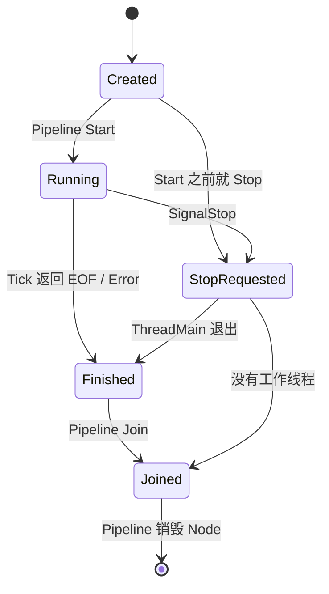
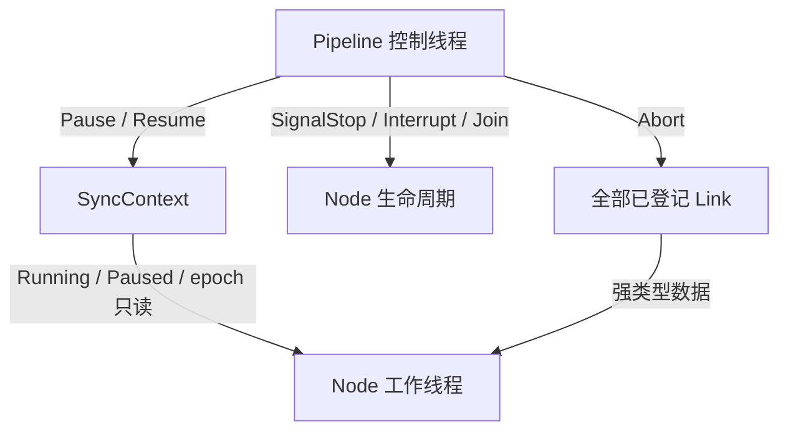

# ARCHITECTURE

> This document explains the implementation details and protocols of components that have already been completed and merged. For the high-level target architecture, see [README.md](./README.md). For current repository progress, see [DEVELOPMENT_PLAN.md](./DEVELOPMENT_PLAN.md).

本文只描述**已经落地并且有正式测试支撑**的机制，全部内容以 `mediacore/src/` 下的源码和 `tests/dag/` 下的用例为事实来源。尚未实现的节点、Seek 流程、网络协议和硬解路径不在本文范围内。

覆盖范围：

```text
mediacore/src/utils/thread_safe_queue.h    有界阻塞队列
mediacore/src/dag/link.h                   Link<T> / ILinkControl / LinkCreationToken
mediacore/src/dag/inode.h                  INodeBase / INode 四个形态
mediacore/src/dag/sync_context.h           SyncContext
mediacore/src/dag/pipeline.h               Pipeline
mediacore/src/av_types/packet.h/.cpp       Packet
tests/dag/d9_dag_lifecycle_test.cpp        11 个生命周期用例
```

---

## 1. 分层与职责边界

已实现的依赖方向：

```text
Pipeline
  ├── INodeBase / INode<InT, OutT>   Node 线程生命周期与端口
  ├── Link<T>                        强类型数据边
  │     └── ThreadSafeQueue<T>       有界阻塞队列
  └── SyncContext                    运行/暂停门控 + epoch
```

| 类型 | 负责 | 不负责 |
|---|---|---|
| `Pipeline` | 创建并登记 Node/Link，启动、暂停、恢复、停止和 Join 整张图 | 具体媒体处理；当前不含 Open / Build / Seek |
| `SyncContext` | 保存全部 Node 共享的 Running/Paused 状态和 epoch，实现暂停等待 | Pipeline 生命周期状态、Node 停止标志、Link 所有权 |
| `INodeBase` | 单个 Node 的一次性线程生命周期、固定 `ThreadMain`、停止标志、退出原因、异常边界 | 完整拓扑、Link 的统一中止 |
| `INode<InT, OutT>` | 零或一个输入端口、零或一个输出端口的强类型连接和收发辅助 | 多输入、多输出拓扑 |
| `Link<T>` | 包装强类型有界队列，提供 Send / Receive / Close / Abort | 决定正常 EOF 或立即停止的时机 |
| `ThreadSafeQueue<T>` | 有界阻塞、背压、Close 排空、Abort 中止 | DAG 类型关系和媒体语义 |

`PlayerFacade`、FSM、真实媒体组图尚未实现，`app/` 当前直接通过 `CreatePlayer()` 拿到 `StubPlayer`。

---

## 2. ThreadSafeQueue：背压与两种关闭

`thread_safe_queue.h`。一把 `mutex_` 保护 `queue_`、`closed_`、`aborted_`；两个条件变量 `not_full_cv_` 和 `not_empty_cv_` 分别等待"有空位"和"有数据"。

### 2.1 接口语义

| 操作 | 行为 |
|---|---|
| `Push(T)` | 队列满时阻塞；`closed_` 或 `aborted_` 时返回 false |
| `Pop()` | 队列空时阻塞；`aborted_` 立即返回 `nullopt`；`closed_` 且已排空返回 `nullopt` |
| `Close()` | 置 `closed_`，唤醒两个 CV。之后 Push 失败，Pop 可继续排空 |
| `Abort()` | 置 `aborted_`，唤醒两个 CV，随后 swap 出内部队列丢弃存量 |

### 2.2 三个实现细节

**容量 0 在构造函数直接抛异常。** 容量 0 的有界队列会让 `Push()` 永久等待，没有任何合法用途，所以 `capacity_ == 0` 时抛 `std::invalid_argument`。

**修改共享数据后先 `unlock()` 再 `notify_one()`。** `Push()` 和 `Pop()` 都是这个顺序。如果持锁通知，被唤醒的线程会立刻阻塞在同一把 mutex 上，多一次无谓的上下文切换。

**`Abort()` 先发布状态并通知，最后才清缓存。** 顺序是：加锁置 `aborted_` → 解锁 → `notify_all()` 两个 CV → 再加锁 swap 出队列。这个顺序不能反：如果先清缓存再通知，而清缓存阶段抛异常（元素析构抛异常），等待中的线程就永远醒不过来，`Pipeline::Stop()` 会卡在 Join 上。

### 2.3 Close 与 Abort 的区别

| 操作 | 后续 Send | 已入队数据 | 阻塞线程 | 用途 |
|---|---|---|---|---|
| `Close()` | 失败 | 下游可继续 Receive，排空后得到 `nullopt` | 被唤醒，按排空规则返回 | 正常 EOF |
| `Abort()` | 失败 | 立即丢弃 | Send 和 Receive 都被唤醒并失败 | Pipeline 立即停止 |

两者都是幂等的，且不可恢复。Stop 之后不能复用原 Link，也不能重新 Start 原 Pipeline。

---

## 3. Link：类型擦除与创建权限

`link.h`。`Link<T>` 是 `ThreadSafeQueue<T>` 的语义包装，`Send`/`Receive`/`Close` 直接转发到 `Push`/`Pop`/`Close`。它额外解决两个问题。

### 3.1 类型擦除的控制接口

`Link<int>` 和 `Link<Packet>` 是无关类型，无法放进同一个容器。做法是让 `Link<T>` 继承非模板基类 `ILinkControl`，Pipeline 保存 `vector<shared_ptr<ILinkControl>>`，`Stop()` 遍历调用 `Abort()`，不需要知道具体数据类型。

`ILinkControl::Abort()` 是 **private 纯虚函数 + `friend class Pipeline`**。Node 即使持有 `shared_ptr<Link<T>>` 也调用不到它 —— 立即停止的决定权只在 Pipeline。`Link<T>::Abort()` 同样是 private + `friend class Pipeline`。

### 3.2 创建令牌

`Link` 的构造函数要求传入 `LinkCreationToken`，而 `LinkCreationToken` 的默认构造函数是 private 且只 `friend Pipeline`。效果是**只有 `Pipeline::CreateLink<T>()` 能造出 Link**，任何 Node 想私自 `make_shared<Link<T>>` 都编译不过。

这保证每条 Link 都被登记进 `links_`，Stop 时不会漏掉某条边，导致某个线程永远阻塞在未 Abort 的队列上。

令牌本身有两个 `static_assert` 守着：

```cpp
static_assert(!std::is_aggregate_v<LinkCreationToken>, ...);
static_assert(!std::is_default_constructible_v<LinkCreationToken>, ...);
```

第一条防止 C++17 把它识别为 aggregate 类型 —— 那样 `LinkCreationToken{}` 会绕过访问控制直接聚合初始化。为此令牌显式写了一个 private 的用户提供构造函数。第二条确认默认构造确实不对外可见。

令牌**允许拷贝和移动**，因为它要按值穿过 `std::make_shared` 的可变参数模板传给 `Link` 的构造函数。

### 3.3 方向性

Link 是单向的：上游负责 `Send()` 和正常 `Close()`，下游只负责 `Receive()`。**没有 `CloseInput()`** —— 接收方不能替上游宣布 EOF。

一条 Link 默认连接一个生产者和一个消费者。两个消费者竞争同一队列不是广播，每个数据项只会被其中一个取到。

---

## 4. SyncContext：运行门控与 epoch

`sync_context.h`。一个 Pipeline 一份，通过 `shared_ptr` 注入该图全部 Node。

### 4.1 暂停等待

```cpp
template <typename StopPredicate>
void WaitWhilePaused(StopPredicate should_stop);
```

先做一次无锁快速检查：`state_ != kPaused || should_stop()` 成立就直接返回，正常运行时不会碰锁。否则加 `pause_mutex_`，进入 `pause_cv_.wait(lock, predicate)`。

谓词版本的 `wait` 处理两件事：虚假唤醒，以及"通知先于等待注册"的竞态 —— 加锁后重新检查谓词，如果状态已经变了就不会进入等待。

用模板直接接收谓词而不是 `std::function`，避免每次循环构造一个类型擦除对象。

### 4.2 状态与写入权限

`PipelineRunState` 只有 `kRunning` / `kPaused` 两个值，表示 Node 是否可以开始下一次 `Tick()`。

四个写接口全部是 private + `friend class Pipeline`：

| 函数 | 行为 |
|---|---|
| `SetRunning()` | 持锁写状态，解锁后 `notify_all()` |
| `SetPaused()` | 持锁写状态，不通知（不需要唤醒任何人） |
| `WakeAllPausedThreads()` | 持锁 `notify_all()`，不改状态 |
| `BumpEpoch()` | `fetch_add(1) + 1`，返回新 epoch |

`state_` 是 `atomic<PipelineRunState>`，写入时持 `pause_mutex_`，读取可由 Node 并发无锁执行。持锁写入是为了和 `WaitWhilePaused` 的等待注册串起来，避免检查与等待之间出现空档。

`Pipeline::GetSyncContext()` 返回 `shared_ptr<const SyncContext>`，外部拿到的是 const 视图，加上 private 写接口，双重保证 Node 和 UI 改不了运行状态。

### 4.3 epoch

`epoch_` 是 `atomic<uint64_t>`，初值 0。`INodeBase::ShouldDropStaleItem(item_epoch)` 比较 `item_epoch < GetEpoch()`，小于说明是 Seek 之前产生的陈旧数据。

**当前 epoch 只是一个计数器。** `BumpEpoch()` 已实现，但没有任何调用方 —— Seek 流程尚未实现。epoch 本身不清空队列、不刷新解码器、不定位媒体，这些是后续 Seek 里程碑的工作。

### 4.4 停止标志为什么不放这里

Node 的停止标志是每个 `INodeBase` 自己的 `atomic<bool> stop_requested_`，不在 `SyncContext` 中。

暂停是可逆的图级状态，停止是不可逆的单节点生命周期终点。合并成一个状态就无法表达"暂停中收到停止请求"这种组合 —— 而 `d9.stop_while_paused` 用例恰恰要验证这条路径。

---

## 5. Node 线程协议

`inode.h`，分成两层：`INodeBase` 管线程，`INode<InT, OutT>` 管端口。

### 5.1 状态机



暂停不是 `NodeState`。暂停期间 Node 仍在已启动生命周期内，只是等在 `SyncContext` 的条件变量上。

### 5.2 ThreadMain

`ThreadMain()` 是固定的非虚 private 函数，声明 `noexcept`：

```text
while (true):
    sync_ctx_->WaitWhilePaused([this]{ return IsStopRequested(); })
    if IsStopRequested():   reason = kStopRequested; break
    result = Tick()
    if IsStopRequested():   reason = kStopRequested; break
    if result == kContinue:      continue
    if result == kEndOfStream:   CloseOutputs(); reason = kEndOfStream; break
    if result == kStopped:       reason = kStopRequested; break
    reason = kError; break
catch (...):
    unhandled_exception_ = std::current_exception()
    reason = kUnhandledException
finish_reason_.store(reason)
state_.store(kFinished)
```

**`Tick()` 前后各查一次停止标志。** 前面查，是防止暂停被唤醒后又去处理一轮数据。后面查，是因为 Stop 可能与 `Tick()` 并发：Pipeline 已经 Abort 了 Link，`Receive()` 返回 `nullopt`，Node 的 `Tick()` 会把它当成正常 EOF 返回 `kEndOfStream`。如果不再查一次，一次强制中止就会被记成正常流结束。停止请求的优先级高于 `Tick()` 的业务返回值。

**EOF 分支 `break` 而不是 `continue`。** 关闭输出后再调 `Tick()` 可能空转或重复阻塞。

**`catch (...)` 兜在线程入口。** C++ 异常越过线程边界会直接 `std::terminate()`。这里捕获后存进 `exception_ptr`，Pipeline `Join()` 之后可以读出来。`GetUnhandledException()` 在 Node 未进入 `kJoined` 时抛 `std::logic_error` —— 未 Join 就读 `exception_ptr` 是数据竞争。

`d9.tick_exception` 用例覆盖这条路径。

### 5.3 Start / Stop / Join 分离

四个控制函数都是 private + `friend class Pipeline`，具体 Node 无法自己调用。

**`Start(thread_factory)`** 用 CAS 而不是简单赋值：

```cpp
NodeState expected = NodeState::kCreated;
if (!state_.compare_exchange_strong(expected, NodeState::kRunning)) {
    if (expected == NodeState::kStopRequested) return kStopAlreadyRequested;
    return kAlreadyStarted;
}
```

CAS 失败时 `expected` 被写成实际值，据此区分"已经启动过"和"启动前已收到停止请求"。线程工厂抛异常或返回不可 Join 的线程时，状态回滚到 `kCreated`，交给 Pipeline 统一回滚。`d9.partial_start_rollback` 用例通过注入一个会失败的线程工厂来验证这条路径。

**`SignalStop()`** 只置标志并用 CAS 循环把状态推到 `kStopRequested`，**不阻塞**。已在 `kStopRequested` / `kFinished` / `kJoined` 的 Node 不再改状态。

**`InterruptBlockingIo()`** 先检查 `thread_.joinable()`，再调派生类的 `OnInterruptBlockingIo()`。

**`Join()`** 区分四种结果：已 Join、没有线程（也记为 `kJoined`，让 Pipeline 用同一套检查）、工作线程试图 Join 自己（拒绝，否则死锁）、`join()` 抛异常。

### 5.4 析构函数不做 Stop / Join

```cpp
virtual ~INodeBase() {
    assert(!thread_.joinable() && "Pipeline must join every Node before destruction");
}
```

只断言，不兜底。如果基类析构里隐式 Join，就会掩盖"Pipeline 漏停了某个 Node"的 bug；而且析构顺序与 Link 生命周期一旦交错，问题极难定位。Debug 构建直接 assert 失败更好。关闭 assert 的构建中，joinable 的 `std::thread` 析构本来就会 `std::terminate()`。

`d9.join_before_destruction` 用例验证 Node 析构前状态确实是 `kJoined`。

### 5.5 端口模板

`INode<InT, OutT>` 是模板 + 三个偏特化，用 `NoPort` 空结构体触发：

| 形态 | 特化 | 提供的接口 |
|---|---|---|
| 一进一出 | `INode<InT, OutT>` | `ConnectInput` / `ConnectOutput` / `ReceiveInput` / `SendOutput` |
| 零进一出 | `INode<NoPort, OutT>` | `ConnectOutput` / `SendOutput` |
| 一进零出 | `INode<InT, NoPort>` | `ConnectInput` / `ReceiveInput` |
| 无端口 | `INode<NoPort, NoPort>` | 无 |

用 `NoPort` 而不是 `void`：`Link<void>` 是非法类型，编译器一旦尝试实例化就报错，偏特化能在实例化之前挡掉。

`ConnectInput` / `ConnectOutput` 内部检查 `CanConfigure()`（即 `state_ == kCreated`）并拒绝空指针，运行中改拓扑会返回 false。

`CloseOutputs()` 在 `INodeBase` 中是**纯虚**，四个端口模板各自提供 `final` 实现。纯虚的意义：将来直接继承 `INodeBase` 的多端口 Node（双输出 Demuxer、双输入 Muxer、多输出 Tee）必须显式回答"正常 EOF 时关哪几条输出"，漏写就是抽象类，编译期失败。`final` 的意义：用端口模板的 Node 一律走同一套关闭规则，不允许各自改写。

多输入或多输出的 Node 直接继承 `INodeBase`，自己持有需要的几条 Link。不为它们发明 `Link<void>` 或可变端口容器。

---

## 6. Pipeline

`pipeline.h`。

### 6.1 持有的对象

```text
Pipeline
  ├── shared_ptr<SyncContext>              构造时创建，注入全部 Node
  ├── vector<unique_ptr<INodeBase>>        独占全部 Node，按登记顺序
  ├── vector<shared_ptr<ILinkControl>>     登记全部 Link，Stop 时统一 Abort
  ├── NodeThreadFactory                    线程创建函数，可注入
  └── PipelineState                        普通枚举，非 atomic
```

`PipelineState`：`kBuilding → kStarting → kRunning → kStopping → kStopped`，一次性，Stop 后不能重新 Start。

### 6.2 为什么 PipelineState 不是 atomic

`CreateLink`、`EmplaceNode`、`Start`、`Pause`、`Resume`、`Stop` 和析构必须由同一个控制线程串行调用。状态枚举和 `nodes_`、`links_`、停止流程共同构成一次完整的状态转换 —— 把一个枚举改成 atomic 并不能让这些复合操作支持并发调用，只会掩盖竞态。

真正需要跨线程读的量才用 atomic：`NodeState`、`stop_requested_`、`finish_reason_`、`PipelineRunState`、`epoch`。

将来 UI 接入后如果命令来自不同线程，应由 Player 层的控制执行器先串行化，再调用 Pipeline。

### 6.3 为什么没有 PipelineState::kPaused

`kRunning` 表示图已启动且尚未停止。图内工作线程当前是跑还是停，由 `SyncContext::PipelineRunState` 表示。因此：

- `Pause()` 成功后 `PipelineState` 仍是 `kRunning`，`PipelineRunState` 变 `kPaused`
- `Resume()` 成功后 `PipelineState` 仍是 `kRunning`，`PipelineRunState` 变 `kRunning`
- 反复 Pause/Resume/Pause 不需要重建 Node 或 Link
- Stop 是一次性生命周期终点，完成后不能重新 Start

`d9.pause_resume_pause` 用例覆盖反复暂停恢复。

### 6.4 组图

```cpp
auto link = pipeline.CreateLink<int>(2);

auto& source = pipeline.EmplaceNode<SourceNode>(probe);
auto& sink   = pipeline.EmplaceNode<SinkNode>(probe);

source.ConnectOutput(link);
sink.ConnectInput(link);
```

`CreateLink<T>(capacity)` 有四个 `static_assert`：T 必须是对象类型、不能是数组、不能带 cv 限定、不能是 `NoPort`。然后 `RequireBuilding()` 检查状态，`make_shared<Link<T>>(capacity, LinkCreationToken{})` 创建并登记到 `links_`。

`EmplaceNode<NodeT>(args...)` 自动注入 SyncContext，实际构造 `NodeT(sync_ctx_, args...)`，调用者只传 Node 自己的参数。四个 `static_assert`：必须继承 `INodeBase`、必须公开且无歧义继承、不能是抽象类、必须能用 `(shared_ptr<SyncContext>, Args...)` 构造。

返回的引用为什么有效：Node 本体由 `make_unique` 分配在稳定的动态存储上，`vector` 扩容移动的是 `unique_ptr` 而非 Node 对象。引用只用于组图或查询，不拥有 Node，不能越过 Pipeline 生命周期。

### 6.5 Start

前置条件：状态是 `kBuilding`、至少一个 Node、Node 按 Source → Sink 登记、端口已连接。

```cpp
for (auto it = nodes_.rbegin(); it != nodes_.rend(); ++it) {
    if ((*it)->Start(thread_factory_) != NodeStartResult::kStarted) {
        return Stop() ? kNodeStartFailed : kRollbackFailed;
    }
}
```

**反向遍历，消费者先启动。** 如果生产者先跑起来而消费者还没启动，数据会堆到队列满、生产者阻塞在 `Send()` 上；虽然最终能恢复，但启动阶段行为不确定。

任一 Node 启动失败立即调完整 `Stop()` 回滚已启动的线程。

**当前 Pipeline 不分析 Link 连接关系，也不做拓扑排序。** 登记顺序错了框架不会自动发现。`d9.consumer_starts_first` 用例验证实际启动顺序是 Sink 先于 Source。

### 6.6 Stop 的五个阶段

```text
1. SignalStop(每个 Node)           让全图先看见停止请求，包括还没建线程的 Node
2. Abort(每条已登记 Link)          唤醒阻塞在 Send() / Receive() 的线程
3. InterruptBlockingIo(每个 Node)  打断 Link 之外的外部阻塞 I/O
4. WakeAllPausedThreads()          唤醒等在暂停条件变量上的线程
5. Join(每个 Node)                 等线程物理退出并回收
```

顺序的含义：

1. 先让所有 Node 的停止谓词变成 true
2. 再让阻塞在空队列 Receive 或满队列 Send 的线程返回
3. 再请求外部文件、网络或音频 I/O 返回
4. 最后唤醒暂停条件变量，让等待谓词能观察到停止请求
5. 所有可能的阻塞都解除后，统一 Join

先设标志再解阻塞，是为了让线程醒来时一定能看到停止请求，走"停止"分支而不是继续处理数据。反过来的话，线程可能在标志设好之前就醒了、转一圈回去又阻塞，Stop 变成竞态。

**Link 由 Pipeline 统一遍历 Abort，Node 不负责中止自己的 Link。** 这避免多输入多输出 Node 漏掉某条边，也避免停止正确性依赖派生类钩子。

**`Stop()` 声明 `noexcept`**，因为析构函数会调它。中间步骤的异常转成返回 false，但**停止流程不中断** —— 剩下的 Node 还是要 Join，否则线程泄漏。

只要有一个 Node 没 Join 成功（`kCannotJoinSelf` 或 `kJoinFailed`），状态就不进 `kStopped`，函数返回 false。

重复调用：已经 `kStopped` 时返回首次的 `stop_succeeded_`；`stop_in_progress_` 为 true 时返回 false。`stop_in_progress_` 只防止停止钩子同步重入，不是通用并发锁 —— 当前 Stop 不承诺与 Start / Pause / Resume 并发调用。

`d9.stop_while_receiving`、`d9.stop_while_sending`、`d9.stop_while_paused`、`d9.interrupt_blocking_io`、`d9.repeated_stop` 覆盖这些路径。

### 6.7 析构

```cpp
~Pipeline() {
    const bool stop_succeeded = Stop();
    (void)stop_succeeded;
    if (state_ != PipelineState::kStopped) {
        std::terminate();
    }
}
```

析构里调 `Stop()` 是安全网，正常控制路径仍应显式停止并检查结果。状态不是 `kStopped` 说明仍有线程未 Join，继续销毁会让运行中的线程访问已释放的 Link，所以直接 `terminate()`。

注意判断依据是**状态**而不是 `Stop()` 的返回值：返回 false 也可能只是某条 Link 的 Abort 抛了异常，那种情况下线程其实已经全部 Join 完。

---

## 7. 所有权与生命周期

```text
unique_ptr<Pipeline>
  ├── vector<unique_ptr<INodeBase>>        Pipeline 独占 Node
  ├── vector<shared_ptr<ILinkControl>>     Pipeline 与两端 Node 共享 Link
  └── shared_ptr<SyncContext>              Pipeline 与全部 Node 共享

Node A ──shared_ptr<Link<T>>── Node B
Node N ──shared_ptr<SyncContext>── Pipeline
```

| 对象 | 创建者 | 持有方式 | 销毁条件 |
|---|---|---|---|
| Node | `Pipeline::EmplaceNode` | Pipeline 独占 `unique_ptr` | 该 Node 线程已 Join |
| Link | `Pipeline::CreateLink` | Pipeline + 两端 Node 共享 `shared_ptr` | 所有持有者释放 |
| `SyncContext` | `Pipeline` 构造函数 | Pipeline + 全部 Node 共享 `shared_ptr` | Node 和 Pipeline 全部释放 |
| `ThreadSafeQueue` | 随 `Link<T>` 构造 | `Link<T>` 的值成员 | 随 Link 销毁 |

**硬约束：Node 必须由 Pipeline 停止并 Join 之后才能析构。**

Link 用 `shared_ptr` 共享而不是 Pipeline 独占，是防止析构顺序出错时 Node 线程访问已释放的队列 —— 但这只是安全网，正确路径始终是先 Join 再销毁。

`Pipeline` 不是进程级单例，多个播放器实例可以各有一条独立 Pipeline 和 SyncContext。

不可拷贝不可移动的对象：`ThreadSafeQueue`（含 mutex 和 CV）、`Link` / `ILinkControl`（内嵌队列）、`SyncContext`（含 mutex 和 CV）、`INodeBase`（地址被工作线程捕获）、`Pipeline`。

---

## 8. 控制权边界



编译期强制的规则：

| 规则 | 实现手段 |
|---|---|
| 只有 Pipeline 能创建 Link | `LinkCreationToken` 私有构造 + `friend Pipeline` |
| 只有 Pipeline 能 Abort Link | `ILinkControl::Abort()` private 纯虚 + `friend Pipeline` |
| 只有 Pipeline 能改运行状态和 epoch | `SyncContext` 四个写函数 private + `friend Pipeline` |
| 只有 Pipeline 能启停 Node | `Start` / `SignalStop` / `InterruptBlockingIo` / `Join` private + `friend Pipeline` |
| 外部拿不到可写的 SyncContext | `GetSyncContext()` 返回 `shared_ptr<const SyncContext>` |
| 多端口 Node 必须自己实现 EOF 关闭 | `CloseOutputs()` 在 `INodeBase` 中是纯虚 |
| 运行中不能改拓扑 | `CanConfigure()` / `RequireBuilding()` 运行期检查 |

---

## 9. Packet DTO

`av_types/packet.h` / `packet.cpp`。

RAII 封装 `AVPacket*`：构造时 `av_packet_alloc()`（只分配结构体，不分配 data 缓冲），析构时 `av_packet_free()`。

**禁止拷贝，支持移动。** `AVPacket` 深拷贝代价高，DAG 中传递一律用移动。移动构造窃取指针后把源对象的 `pkt_` 置 nullptr、其他字段清零；移动赋值先释放自己持有的资源再窃取，并做自赋值检查。

携带的元信息：

| 字段 | 含义 |
|---|---|
| `pts_us_` / `dts_us_` | 微秒时间戳。FFmpeg 的 `pts`/`dts` 以各流自己的 `time_base` 为单位，在 Demuxer 一次换算成微秒后，下游不必关心 `time_base`，同步节点也能直接比较音视频时间戳 |
| `epoch_` | Seek 世代号，从 `SyncContext::GetEpoch()` 读取 |
| `flags_` | `AVFrameFlag` 位掩码：`kKeyFrame` / `kEOF` / `kFlush` |

`AVFrameFlag` 定义在公共头 `include/mediacore/av_types/av_frame_flag.h`，用 `enum class` + `constexpr` 位运算重载。

**已知不一致：** `VideoFrame`（`video_frame.h`）目前有自己的一套 `FrameFlag`（只有 `kNone` / `kFlush` / `kEOF`），与 `Packet` 使用的 `AVFrameFlag` 并存。两套标志的统一是后续 Frame 协议里程碑的工作，当前未收口。

`Packet` 目前**没有任何生产者或消费者** —— Demuxer 和 Decoder 尚未实现。它是独立完成的 DTO，不代表解封装能力已经存在。

---

## 10. 测试覆盖

`tests/dag/d9_dag_lifecycle_test.cpp`，11 个用例，每个在 CMake 中注册为独立 CTest（`d9.<name>`），单个用例 `TIMEOUT 10` 秒。

测试只实例化 Queue / Link / INode / Pipeline，不创建 FFmpeg 或 Qt 对象，因此可以在关掉 `BUILD_MEDIACORE` 和 `BUILD_APP` 的环境下单独构建。

**不用固定时长 sleep 判断线程是否已运行。** 测试用 `TestEvent`（mutex + CV + 序号）等待确定事件，`Probe` 中的可观察状态全是 atomic。`GateNode` 让测试方通过 `ReleaseTick()` 精确控制 `Tick()` 何时返回，从而能先提交 Pause、再让 `Tick()` 到达工作循环边界，确定性地验证暂停等待而不是碰运气验证一个时间窗口。

| 用例 | 验证内容 |
|---|---|
| `eof_close_and_drain` | Source → Transform → Sink 的正常 EOF、`CloseOutputs()` 和下游排空 |
| `stop_while_receiving` | 阻塞在空 Link `Receive()` 的 Node 被 `Abort()` 解除 |
| `stop_while_sending` | 阻塞在满 Link `Send()` 的 Node 被 `Abort()` 解除 |
| `stop_while_paused` | 暂停等待中的 Node 被 Stop 唤醒并 Join |
| `pause_resume_pause` | 连续 Pause/Resume/Pause 的状态和线程行为 |
| `interrupt_blocking_io` | Pipeline 调用 Node 的 `OnInterruptBlockingIo()` 回调 |
| `partial_start_rollback` | 部分线程创建失败时已启动 Node 被回滚并 Join |
| `repeated_stop` | 重复 Stop 的返回值和生命周期状态稳定 |
| `tick_exception` | `Tick()` 异常在线程边界保存，Join 后可读取 |
| `join_before_destruction` | Pipeline 释放 Node 前先完成 Join |
| `consumer_starts_first` | 按 Source → Sink 登记时，Sink 先于 Source 启动 |

验证环境和 Sanitizer 运行方式见 [tests/dag/README.md](./tests/dag/README.md)，通过状态见 [DEVELOPMENT_PLAN.md](./DEVELOPMENT_PLAN.md)。

---

## 11. 尚未实现

以下机制**没有代码**，本文不描述它们的实现协议。设计意图见 README 的目标架构，落地时间见开发计划：

- `PlayerFacade`、FSM、`PlaybackState` 的实际驱动（当前 `CreatePlayer()` 返回 `StubPlayer`）
- `Pipeline::Open` / `Build` / `Seek`
- Seek 流程：epoch 递增的调用方、带内 Flush、解码器与音频设备刷新
- 全部真实媒体 Node：Demuxer、Decoder、Sync、Sink、Tee、Encoder、Muxer
- 录制的 Drain 协议
- 硬件解码、DMA-BUF / EGLImage、色彩管理
- HTTP、RTP、Jitter Buffer 及相关 QoS 指标
- 结构化错误上报通道
