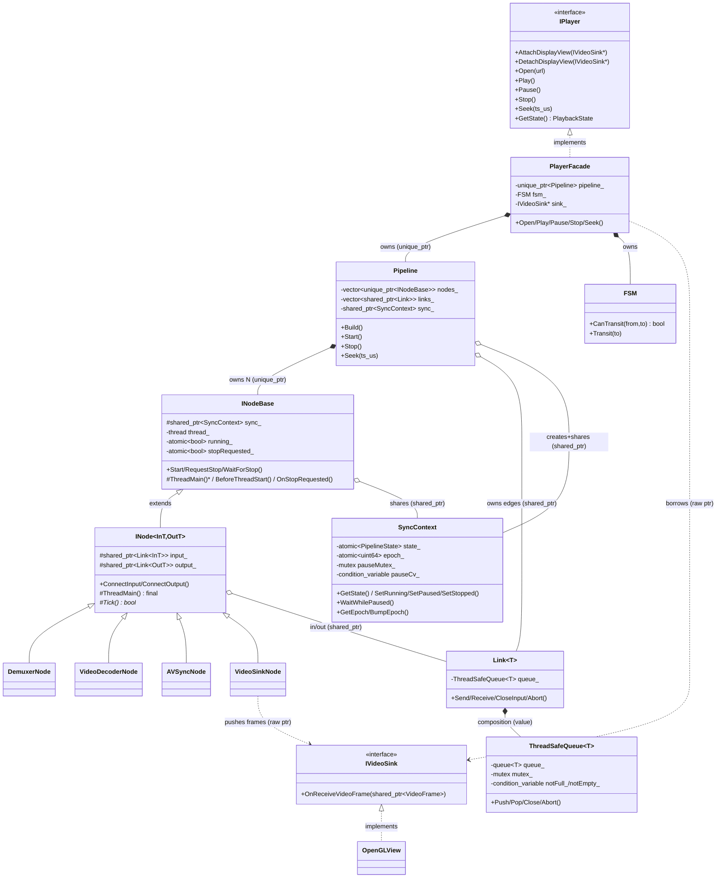
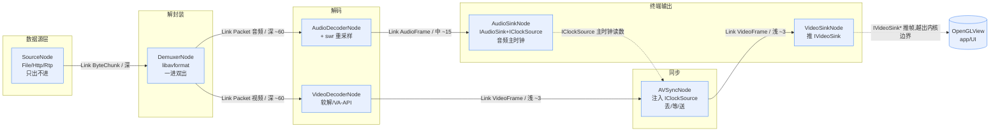
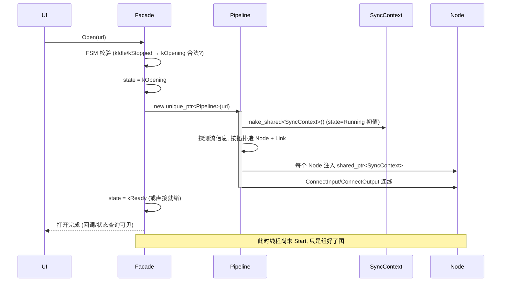
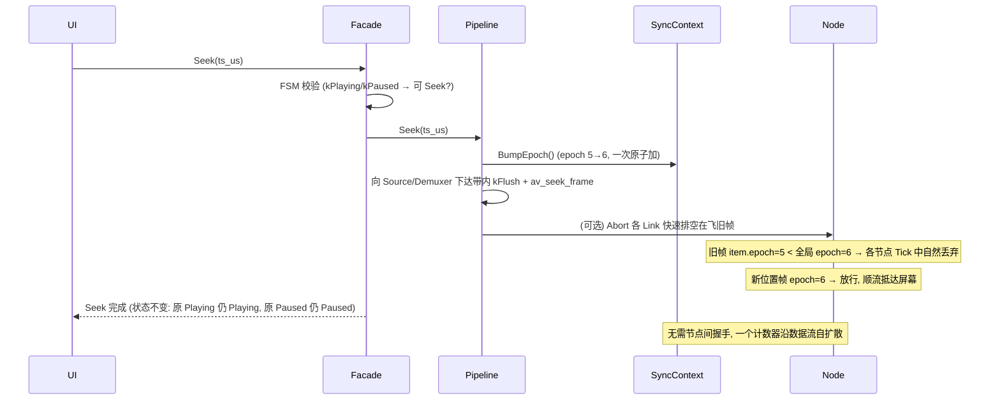
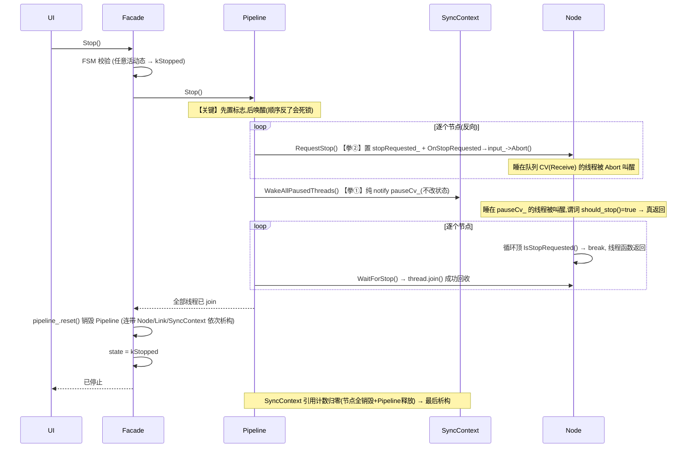
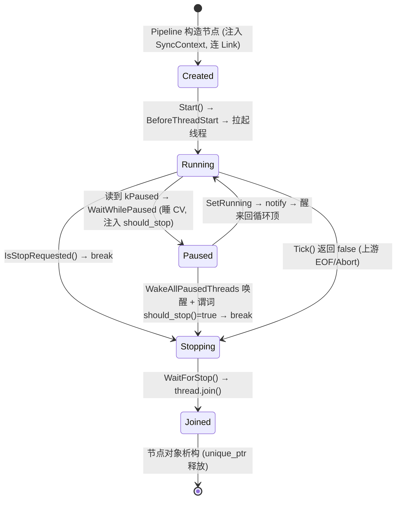

# AI Media Player 架构设计文档

> 本文档统一定义整个播放器的**分层、职责边界、所有权模型、控制流/数据流/生命周期**，
> 是后续所有编码（D9 及以后）的唯一权威依据。任何与本文冲突的代码都应以本文为准修正。
>
> 工程哲学：**DAG 数据流 + 分层解耦 + RAII 所有权 + 单一职责**。

---

## 0. 三条正交的轴

理解本架构的钥匙：把系统拆成**三条互不干扰的轴**，每条轴回答一个独立问题。

| 轴 | 回答的问题 | 载体 | 方向 |
|----|-----------|------|------|
| **数据流** | 像素/采样怎么从文件流到屏幕？ | `Link<T>` 有界队列 | Source → Sink（单向） |
| **控制流** | 播放/暂停/Seek 指令怎么下达？ | `SyncContext`（全局态+epoch）+ 节点停止标志 | UI → Player → Pipeline → 各 Node |
| **生命周期** | 谁创建/销毁谁？谁 join 谁？ | 所有权（unique/shared/裸指针） | 由外向内创建，由内向外销毁 |

**三轴分离**是本架构的核心：数据流只管搬运，控制流只管发令，生命周期只管存亡。
一个 Bug 若跨轴（例如"停止"既要停数据又要管销毁），就要拆开到各自的轴上分别处理。

---

## 1. 分层与职责边界

自顶向下五层，每层只依赖其下一层的**抽象**，不感知实现：

```
┌──────────────────────────────────────────────────────────┐
│  app/ (Qt GUI)   PlayerWidget / OpenGLView / Controller   │  UI 层
│      依赖 ↓ 仅 IPlayer + IVideoSink 两个纯接口               │
├──────────────────────────────────────────────────────────┤
│  PlayerFacade (implements IPlayer)                         │  门面层
│      翻译 UI 指令 → Pipeline 操作；持有 FSM 校验状态跃迁      │
├──────────────────────────────────────────────────────────┤
│  Pipeline                                                  │  编排层
│      Build 组图 / Start / Stop / Seek；拥有全部 Node 与 Link │
├──────────────────────────────────────────────────────────┤
│  INodeBase / INode<InT,OutT>  +  各具体 Node                │  节点层
│      每节点 1 线程；标准三态循环；只做"处理一个数据项"         │
├──────────────────────────────────────────────────────────┤
│  Link<T> / ThreadSafeQueue<T> / SyncContext                │  基石层
│      数据通道（背压队列）+ 控制总线（atomic 态+epoch）        │
└──────────────────────────────────────────────────────────┘
```

### 每个类"负责什么 / 不负责什么"

| 类 | ✅ 负责 | ❌ 不负责 |
|----|--------|----------|
| **IPlayer**（接口） | 定义 UI 可见的能力契约（Open/Play/Pause/Stop/Seek/状态查询/Sink 注入） | 任何实现细节；不知道 Pipeline/Node 存在 |
| **IVideoSink**（接口） | 定义"接收一帧"的契约 `OnReceiveVideoFrame` | 帧从哪来；解码/同步细节 |
| **PlayerFacade** | 实现 IPlayer；把 UI 指令翻译成 Pipeline 调用；持 FSM 校验跃迁合法性；创建/销毁 Pipeline | 不碰线程、不碰队列、不解码；不做具体音视频处理 |
| **FSM** | 维护合法状态跃迁表（如 kStopped 不能直接 Pause）；拒绝非法跃迁 | 不执行动作，只判定"这个跃迁允不允许" |
| **Pipeline** | Build 拓扑（造 Node、造 Link、连线）；按序 Start/Stop；持有全部 Node 和 Link 的所有权；创建唯一的 SyncContext | 不定义节点内部怎么处理数据；不感知 UI |
| **SyncContext** | 持有全局运行态（Running/Paused/Stopped）+ Seek epoch；提供切态与"暂停等待"；notify 暂停 CV | 不持有任何 Node/Link；不知道有几个节点；不做数据处理 |
| **INodeBase** | 单节点线程生命周期（Start/RequestStop/WaitForStop）；持 shared_ptr<SyncContext> 读全局态；标准循环骨架的停止/暂停判定 | 不知道数据类型；不知道上下游是谁 |
| **INode<InT,OutT>** | 强类型输入/输出 Link 的持有与连接；标准三态循环 ThreadMain；暴露纯虚 Tick() | 不定义"一个数据项具体怎么处理"（交给子类 Tick） |
| **具体 Node**（Demuxer/Decoder/…） | 实现 Tick()：收一个→处理→发一个；epoch 过滤陈旧帧 | 不管线程怎么起停（基类管）；不管队列并发（Link 管） |
| **Link\<T>** | 强类型语义管道：Send/Receive/CloseInput/Abort | 不管背压/锁细节（转发给队列）；不管 epoch 过滤（各节点自己比） |
| **ThreadSafeQueue\<T>** | 有界阻塞队列：双 CV 背压、Push/Pop、Close 排空、Abort 丢弃 | 不知道 T 的语义；不知道 DAG 拓扑 |

---

## 2. 所有权模型（本文档最重要的一节）

**核心原则：由外向内创建，由内向外销毁；用 `unique_ptr` 表达独占，`shared_ptr` 表达共享，裸指针表达"只看不拥有"。**

### 2.1 一张所有权全景图

```
                        std::unique_ptr<IPlayer>
   app (main)  ─────────────────────────────────────▶  PlayerFacade
      │  own（独占，工厂返回 unique_ptr）                    │
      │                                                     │ own: std::unique_ptr<Pipeline>
      │  IVideoSink*（裸指针，只引用不拥有）                  ▼
   OpenGLView  ◀───────────────────────────────────  Pipeline
   （app own，                 IVideoSink* 注入          │
    Qt 父子树管理）                                       │ own: vector<unique_ptr<INodeBase>>  （拥有全部节点）
                                                         │ own: vector<shared_ptr<Link<T>>>    （拥有全部连线）
                                                         │ own: shared_ptr<SyncContext>        （创建者，也是共享者之一）
                                                         ▼
                              各 Node ──── shared_ptr<SyncContext> ────┐
                                 │                                     │ 所有节点 + Pipeline
                                 │  each holds                         │ 共享同一个 SyncContext
                                 │  shared_ptr<Link<T>> (in/out)       │
                                 ▼                                     ▼
                              Link<T>  ◀── 被上下游两个节点共享 ──▶  SyncContext（引用计数 = 节点数 + 1）
```

### 2.2 逐条回答所有权问题

**Q: 谁创建 Pipeline？谁销毁 Pipeline？**
- **创建**：`PlayerFacade::Open()` 时创建 `std::unique_ptr<Pipeline>`。Facade 独占拥有它。
- **销毁**：`PlayerFacade::Stop()` 时 `pipeline_.reset()`，或 Facade 自身析构时随 unique_ptr 自动析构。
- **为何是 unique_ptr**：同一时刻只有一条 Pipeline，Facade 是它唯一的拥有者，独占语义最贴切，析构确定性最强（RAII）。

**Q: 谁拥有 SyncContext？**
- **创建者 = Pipeline**（`Build()` 时 `std::make_shared<SyncContext>()`）。
- **拥有者 = Pipeline + 所有 Node**（共享）。引用计数 = 节点数 + 1（Pipeline 自己也留一份，用于 Seek 时 BumpEpoch、停止时 WakeAllPausedThreads）。
- **为何是 shared_ptr 而非 Pipeline 独占**：见下条。

**Q: Node 为什么持有 `shared_ptr<SyncContext>` 而不是裸指针或引用？**
- **共享语义真实存在**：一个 SyncContext 被 N 个节点 + Pipeline 同时使用，这是"多方共享同一对象"的教科书场景。
- **生命周期安全**：节点线程可能在 Pipeline 开始析构后仍在做最后一轮循环（尚未 join 完）。若节点持裸指针，而 SyncContext 已被销毁，就是**悬垂指针 → UB**。shared_ptr 保证"只要还有一个节点活着，SyncContext 就不会死"，天然规避这个竞态。
- **为何不用引用 `SyncContext&`**：引用要求被引用对象在节点整个生命周期内都存活，把生命周期耦合交给了程序员心算，出错即 UB；shared_ptr 用引用计数把这件事自动化。

**Q: Link 是谁创建、谁共享？**
- **创建者 = Pipeline**（`Build()` 时按拓扑 `std::make_shared<Link<T>>(capacity)`）。
- **共享者 = 一条 Link 两端的两个节点**：上游节点 `ConnectOutput(link)`，下游节点 `ConnectInput(link)`，两者各持一个 `shared_ptr<Link<T>>` 指向同一对象。引用计数通常 = 2（+ Pipeline 若也留存）。
- **为何是 shared_ptr**：一条边天然被两个节点共享，且"谁先析构"不确定。shared_ptr 让 Link 随**最后一个**持有者析构，规避"队列被谁释放"的竞态。这也解释了 Tee 多播为何零拷贝——转发的是 `shared_ptr` 引用计数，不是像素。

**Q: `IVideoSink*` 为什么是裸指针而不是 shared_ptr？**
- **所有权不属于 mediacore**：视频接收端（OpenGLView）是 **UI 层（app）创建并拥有**的 Qt Widget，其生命周期由 Qt 的父子对象树管理。mediacore 只是"把帧推给它"，**借用而非拥有**。
- **裸指针正确表达"非拥有观察者（non-owning observer）"**：如果这里用 shared_ptr，mediacore 就参与了 OpenGLView 的生命周期管理——这既不符合事实（Qt 才是它的主人），又会造成 UI 对象被内核延寿的诡异问题。
- **安全边界**：UI 负责在销毁 OpenGLView 前调用 `DetachDisplayView(sink)` 解绑，内核推帧处用 `mutex` 保护 sink_ 读写（见 StubPlayer 的 `sinkMutex_`）。这是"裸指针 + 显式解绑 + 加锁"的经典观察者模式，而非所有权共享。

### 2.3 所有权速查表

| 对象 | 所有者 | 表达方式 | 理由 |
|------|--------|----------|------|
| IPlayer/PlayerFacade | app (main) | `unique_ptr<IPlayer>`（工厂返回） | 独占，确定性析构 |
| Pipeline | PlayerFacade | `unique_ptr<Pipeline>` | 同时只一条，独占 |
| SyncContext | Pipeline 创建，Pipeline+全部 Node 共享 | `shared_ptr<SyncContext>` | 多方共享 + 跨析构存活 |
| 各 Node | Pipeline | `vector<unique_ptr<INodeBase>>` | Pipeline 独占节点，异构统一保管 |
| Link\<T> | Pipeline 创建，两端节点共享 | `shared_ptr<Link<T>>` | 一条边被两节点共享 |
| ThreadSafeQueue\<T> | Link（内嵌成员） | 值成员（组合） | 队列是 Link 的一部分，同生共死 |
| IVideoSink (OpenGLView) | app (UI 层) | `IVideoSink*` 裸指针（内核侧） | 内核借用不拥有，Qt 管其生命周期 |

---

## 3. 类关系 UML



图例：`*--` 组合/独占拥有，`o--` 聚合/共享，`..>` 依赖/借用，`<|--` 继承，`<|..` 实现接口。

---

## 4. 数据流图（Source → Sink）

**单向、强类型、有界背压。** 每个方框是一个节点（独立线程），每条箭头是一个 `Link<T>`（有界队列）。
Link 上标注的是流经的数据类型和建议队列深度（深度按数据体积反比：Packet 深、Frame 浅）。



**要点：**
- 实线 = 数据流（`Link<T>` 队列，携带 epoch 字段）；虚线 = 非数据依赖（时钟读数 / 跨边界推帧）。
- **音频主时钟**：AudioSinkNode 实现 IClockSource，AVSyncNode 注入它、读音频播放进度作为同步基准（音频不可停顿，故做主）。
- **epoch 过滤**：每个节点 Tick() 里比较 `item.epoch < sync_->GetEpoch()` → 丢弃陈旧帧（Seek 后旧帧自然消散）。
- **背压**：任一下游变慢 → 其输入 Link 填满 → 上游 Send 阻塞 → 逐级传导，防止 OOM。

---

## 5. 控制流图（UI → Player → Pipeline → SyncContext → Node）

**控制流与数据流方向相反且正交。** 指令自上而下传播，最终落到两个终点：SyncContext（全局态）或节点停止标志（局部）。

```mermaid
flowchart TD
    UI[UI: 按钮点击<br/>Play/Pause/Seek/Stop] -->|调用 IPlayer 接口| FAC[PlayerFacade]
    FAC -->|1. FSM 校验跃迁合法性| FSM{FSM<br/>允许?}
    FSM -->|非法, 拒绝| UI
    FSM -->|合法| PIPE[Pipeline]

    PIPE -->|Play/Pause: 改全局态| SC[SyncContext]
    PIPE -->|Seek: BumpEpoch| SC
    PIPE -->|Stop: WakeAllPausedThreads + 逐个 RequestStop| NODES

    SC -->|state_ / epoch_<br/>N 个线程高频无锁读| NODES[各 Node 工作线程]
    SC -.->|WakeAllPausedThreads 纯 notify 踹醒| NODES

    NODES -->|循环顶部读态:<br/>Running→干活<br/>Paused→睡CV<br/>Stopped(节点标志)→退出| LOOP[ThreadMain 三态循环]

    classDef ctrl fill:#fce8e6,stroke:#ea4335;
    class SC,FSM ctrl;
```

**两条落点（方案甲）：**
1. **全局态**（Play/Pause/Seek）→ 写 `SyncContext`（state/epoch），所有节点循环下一轮读到即响应。**一声令下，全体同步**。
2. **停止**（Stop）→ 双管齐下：先逐个 `RequestStop()`（置节点标志 `stopRequested_` + Abort 队列 CV），再 `WakeAllPausedThreads()`（纯 notify 暂停 CV，不改状态）。**顺序关键：先置标志，后唤醒**，否则谓词看不到停止信号会再睡回去。

---

## 6. 五大操作时序图

> 参与者统一：`UI` / `Facade`(PlayerFacade+FSM) / `Pipeline` / `SyncContext` / `Node`(代表所有工作线程)。

### 6.1 Open —— 组图并进入就绪



### 6.2 Play —— 启动/恢复

```mermaid
sequenceDiagram
    participant UI
    participant Facade
    participant Pipeline
    participant SyncContext
    participant Node

    UI->>Facade: Play()
    Facade->>Facade: FSM 校验 (kReady/kPaused → kPlaying 合法?)
    alt 首次播放 (线程未起)
        Facade->>Pipeline: Start()
        Pipeline->>SyncContext: SetRunning()
        Pipeline->>Node: 逆数据流逐个 Start() (先消费者后生产者)
        Node->>Node: BeforeThreadStart() 后拉起线程, 进入 ThreadMain 循环
    else 从暂停恢复 (线程在睡)
        Facade->>Pipeline: Resume()
        Pipeline->>SyncContext: SetRunning()
        SyncContext->>Node: pauseCv_.notify_all() 踹醒暂停中的线程
        Node->>Node: WaitWhilePaused 返回, 回循环顶继续 Tick()
    end
    Facade->>Facade: state = kPlaying
    Facade-->>UI: 播放中
    Note over Node: 循环: Running→Tick 干活; 数据开始流动
```

### 6.3 Pause —— 暂停（不退出）

```mermaid
sequenceDiagram
    participant UI
    participant Facade
    participant Pipeline
    participant SyncContext
    participant Node

    UI->>Facade: Pause()
    Facade->>Facade: FSM 校验 (kPlaying → kPaused 合法?)
    Facade->>Pipeline: Pause()
    Pipeline->>SyncContext: SetPaused()  (仅置态, 不 notify)
    Facade->>Facade: state = kPaused
    Facade-->>UI: 已暂停 (主线程立即返回, 不阻塞 UI)
    Note over Node: 各线程下一轮循环顶读到 kPaused
    Node->>SyncContext: WaitWhilePaused() 睡入 pauseCv_ (0% CPU)
    Note over Node: 线程挂起, 不退出; 数据流冻结, 队列存量保留
```

### 6.4 Seek —— 跳转（无锁 epoch）



### 6.5 Stop —— 停止并拆图（两拳唤醒 + 反向回收）



---

## 7. 生命周期图（创建 → 启动 → 暂停 → 恢复 → 停止 → 销毁）

### 7.1 单个节点线程的状态机



### 7.2 整体对象生命周期时间线

```
时间 ───────────────────────────────────────────────────────────────▶

app 启动
  └─ CreatePlayer() ──▶ PlayerFacade 诞生 (unique_ptr, 存活至 app 退出)
                          │
   Open() ───────────────┼─▶ Pipeline 诞生 (unique_ptr)
                          │     ├─ SyncContext 诞生 (shared, rc=1)
                          │     ├─ Link×M 诞生 (shared, rc=2 each)
                          │     └─ Node×N 诞生 (unique, 各持 SyncContext → rc=N+1)
                          │
   Play() ────────────────┼─▶ Node 线程全部 Start (Created→Running)
   Pause()/Play() ────────┼─▶ Running⇄Paused 往返 (对象不生不灭, 只是线程睡/醒)
   Seek() ────────────────┼─▶ epoch++ (对象不动, 只是旧数据被丢)
                          │
   Stop() ────────────────┼─▶ 全部 Node 线程 Joined
                          │     └─ pipeline_.reset():
                          │          Node×N 析构 (SyncContext rc: N+1→1)
                          │          Link×M 析构
                          │          SyncContext 析构 (rc:1→0, Pipeline 最后一份释放)
                          │
app 退出 ─────────────────┴─▶ PlayerFacade 析构 (若未 Stop, 析构中兜底 Stop)
```

**关键生命周期保证：**
- **RAII 层层嵌套**：app 持 Facade，Facade 持 Pipeline，Pipeline 持 Node/Link/SyncContext。任一层析构自动触发下层析构，无需手动 delete。
- **线程 RAII**：`INodeBase` 析构函数兜底 `RequestStop(); WaitForStop();`，保证线程一定被 join，杜绝 `std::terminate`。
- **SyncContext 后死**：因所有节点共享它，它一定在**最后一个节点析构后**才归零销毁——节点线程收尾时读它绝对安全。这正是"节点持 shared_ptr 而非裸指针"的价值兑现。

---

## 8. 双停止机制详解（方案甲：停止归 Node，注入停止判据）

一个工作线程只可能睡死在**两个卡点之一**，停止必须两个都能踹醒：

| 卡点 | 睡眠原因 | 等待的 CV | 由谁唤醒 |
|------|---------|-----------|---------|
| **A** | 暂停 (state==kPaused) | `SyncContext::pauseCv_` | `WakeAllPausedThreads()` 的纯 `notify_all` |
| **B** | 管道空, 等数据 (Receive) | `ThreadSafeQueue::notEmpty_` | `Link::Abort()`（经 RequestStop→OnStopRequested） |

**停止时无法预知线程睡在 A 还是 B，故两拳都要打**：`RequestStop()→Abort()` 敲 B，`WakeAllPausedThreads()` 敲 A。缺任一拳，对应卡点的线程醒不来 → `join()` 挂死。

### 方案甲核心：停止不进全局态，通过注入判据让谓词能"看到"停止

**设计哲学**：
- `PipelineState` 只有 `{kRunning, kPaused}` 两态，**不包含 kStopped**——停止不是"播放状态"，是"线程生命周期终止"。
- 停止信号存于各 Node 的 `stopRequested_`（节点级标志），不污染共享的 SyncContext。
- `WaitWhilePaused` 的谓词需要"看到"停止，但 `stopRequested_` 在 Node、谓词在 SyncContext，怎么桥接？→ **Node 注入一个回调** `should_stop()` 给谓词用。

### 代码实现（三方协同）

#### SyncContext 侧

```cpp
/**
 * @brief 暂停时阻塞，直到恢复播放或收到停止信号
 * @param should_stop 停止判据回调，由调用方(Node)注入，返回 true 表示"该停了"
 * @details 谓词 = "不再暂停(state 变 kRunning)" || "该停了(should_stop()=true)"，
 *          两个条件任一为真即返回。这样 SetRunning(改 state)或 Pipeline::Stop
 *          (RequestStop 置标志 + WakeAllPausedThreads 唤醒)都能让线程出来。
 */
void WaitWhilePaused(const std::function<bool()>& should_stop) {
    std::unique_lock<std::mutex> lock(pauseMutex_);
    pauseCv_.wait(lock, [this, &should_stop] {
        return state_.load() != PipelineState::kPaused   // 恢复播放
            || should_stop();                             // 或停止
    });
}

/**
 * @brief 唤醒所有睡在暂停 CV 上的线程（纯 notify，不改任何状态）
 * @note 调用前**必须**先置好停止标志(RequestStop)，否则谓词 should_stop()
 *       仍为 false，线程被唤醒后复查谓词发现"既不是 Running 又没停"会再睡回去。
 */
void WakeAllPausedThreads() {
    pauseCv_.notify_all();
}
```

#### Node 循环侧

```cpp
void ThreadMain() final {
    while (true) {
        // ① 停止优先：节点级标志
        if (IsStopRequested()) break;

        // ② 暂停：注入自己的停止标志给谓词用
        if (sync_->GetState() == PipelineState::kPaused) {
            sync_->WaitWhilePaused([this] { return IsStopRequested(); });
            continue;   // 醒来回顶：若因停止醒来，下轮①就 break；若因 Resume，走③干活
        }

        // ③ 运行：干活
        if (!Tick()) break;
    }
}
```

#### Pipeline::Stop 侧（顺序是生死攸关的）

```cpp
void Pipeline::Stop() {
    // 【关键】顺序：先置标志，后唤醒（反了会死锁）
    
    // ① 先置所有节点的停止标志 + Abort 队列 CV（踹卡点 B）
    for (auto& node : nodes_) {
        node->RequestStop();   // 置 stopRequested_ + OnStopRequested→input_->Abort()
    }
    
    // ② 再唤醒暂停 CV（踹卡点 A）
    //    此时谓词 should_stop() 已是 true，线程能真正返回
    sync_->WakeAllPausedThreads();
    
    // ③ join 所有线程
    for (auto& node : nodes_) {
        node->WaitForStop();
    }
}
```

### 为什么顺序是"RequestStop 在前，Wake 在后"？

**反例（先 Wake 后 RequestStop，会死锁）**：
```
WakeAllPausedThreads() → notify → wait 醒来复查谓词
  → should_stop()=false(还没 RequestStop) 且 state 仍是 kPaused
  → 谓词返回 false → 立刻又睡回去
随后 RequestStop() 置 stopRequested_ → 但线程已睡死，没人再 notify → join 挂死
```

**正例（先 RequestStop 后 Wake）**：
```
RequestStop() 置所有 stopRequested_=true
  → WakeAllPausedThreads() → notify → wait 醒来复查谓词
  → should_stop()=true → 谓词返回 true → 线程真返回
  → 回循环顶 IsStopRequested()=true → break → join 成功
```

### 对标 GStreamer

GStreamer 的 flush 事件 = 我们的 `Abort()`，用于踹醒阻塞在数据流(pad push/pull)上的线程。我们的方案甲与其一致：**停止由各 element(Node)自己的标志驱动，全局状态机只管播放/暂停**。GStreamer 的 `GST_STATE_NULL` 传播时也是逐 element 设置，而非一个全局 `kStopped` 让所有 element 去查。

---

## 9. 架构自检：SRP / RAII / DAG / 现代播放器

### 9.1 单一职责（SRP）核对

| 类 | 唯一职责 | 是否单一 |
|----|---------|---------|
| IPlayer / IVideoSink | 定义契约 | ✅ 纯接口 |
| PlayerFacade | UI 指令 ↔ Pipeline 操作的翻译 + 状态校验编排 | ✅（不碰线程/队列/解码） |
| FSM | 判定跃迁合法性 | ✅（只判不做） |
| Pipeline | 拓扑装配 + 启停编排 + 所有权容器 | ✅（不定义节点内部逻辑） |
| SyncContext | 全局态 + epoch 的共享存取 | ✅（不持节点、不处理数据） |
| INodeBase | 线程生命周期 | ✅（与数据类型无关） |
| INode | 强类型 Link + 标准循环骨架 | ✅（不定义单项处理） |
| 具体 Node | 实现一种数据变换 (Tick) | ✅ |
| Link | 语义化管道动词 | ✅（转发给队列） |
| ThreadSafeQueue | 线程安全有界队列 | ✅（不知 DAG 语义） |

**结论**：职责切分干净，每类改动原因单一。INodeBase/INode 两层拆分正是 SRP 的典范——"管线程"和"管数据类型"分离。

### 9.2 RAII 核对
- ✅ 所有堆对象由智能指针托管，零裸 `new`/`delete`（IVideoSink* 除外，但那是"借用非拥有"，由 UI 侧 RAII）。
- ✅ 线程被 INodeBase 析构兜底 join。
- ✅ Link/队列/SyncContext 随持有者析构自动回收，引用计数保证顺序安全。
- ✅ FFmpeg 裸资源（AVPacket/AVFrame/AVFormatContext）将在 D10+ 用自定义删除器/RAII 包装（Packet/VideoFrame DTO）。

### 9.3 DAG 解耦核对
- ✅ 节点只认 `input_`/`output_` 两条 Link，**不持有上下游节点指针**——真正的解耦，节点可独立测试（灌一个假 Link 即可）。
- ✅ 强类型 Link 把"接错线"变成编译期错误（`Link<Packet>` ≠ `Link<VideoFrame>`）。
- ✅ 控制流走 SyncContext 广播，**不需要节点间点对点握手**（epoch 自扩散）。

### 9.4 对标现代播放器
- ✅ 线程 + 有界队列 pull 模型 = FFmpeg/GStreamer 主流范式。
- ✅ 全局状态机 + flush = GStreamer element state + flush 事件。
- ✅ 音频主时钟 = ffplay/主流播放器的经典选择。
- ✅ epoch 世代号作废旧帧 = 无锁 seek 的现代做法（优于多标志握手）。

---

## 10. 仍存在的设计风险（诚实清单）

> 以下是当前设计里**尚未闭合**或**需要警惕**的点，按优先级排列。不解决不影响 D9，但要在对应 Day 前想清楚。

1. **【高】停止时的节点回收顺序未定死**
   反向回收（先消费者后生产者）能防"生产者阻塞在 Send 到已死消费者"，但双输出 Demuxer + 汇聚 AVSync 的拓扑不是简单链，**回收序需按拓扑逆序精确定义**，否则仍可能死锁。→ D16 Pipeline 落地时必须给出确定顺序，并写死锁回归测试。

2. **【高】epoch 过滤散落在每个节点，易漏写**
   "比较 epoch 丢弃旧帧"靠各节点 Tick() 自觉执行。任一节点漏写 → Seek 后闪旧画面。→ 需在 INode 层或 DTO 层提供统一的 `ShouldDrop(item)` 辅助，降低漏写概率。

3. **【中】Facade 状态 (PlaybackState) 与 SyncContext 状态 (PipelineState) 双份**
   UI 态和内核机械态是两套枚举，需保证不漂移（如 UI 显示 Playing 但 SyncContext 还是 Paused）。→ 明确"Facade 态是权威，SyncContext 态是其投影"，跃迁时同步更新，禁止各写各的。

4. **【中】IVideoSink 裸指针的解绑时序**
   UI 销毁 OpenGLView 前必须 `DetachDisplayView`，且要保证此刻没有节点线程正在 `OnReceiveVideoFrame` 中途。→ 推帧处加锁（已有 sinkMutex_ 先例）+ Detach 与推帧互斥；文档化"UI 必须先 Detach 再析构 Sink"的契约。

5. **【中】背压 + 暂停的交互**
   暂停时数据流冻结，若某 Link 恰好满，上游线程可能阻塞在 Send（卡点 B 变种）而非睡在暂停 CV。停止时 Abort 能救（打拳②），但要确认所有阻塞点都被两拳覆盖。→ D9 单测需专门构造"暂停中队列满 → 停止"用例。

6. **【低】Seek 期间在飞帧与 kFlush 带内信令的竞态**
   epoch 作废旧帧是"惰性丢弃"，但解码器内部可能已缓存 B 帧重排队列，需 `avcodec_flush_buffers` 配合。→ D17 seek 落地时处理带内 kFlush 与 epoch 的协同。

7. **【低】内存序目前统一 seq_cst**
   求稳但非最优。→ 功能稳定后可将 epoch/state 降到 acquire/release，需配基准测试证明收益，不可拍脑袋改。

---

## 11. 结论

架构在 SRP / RAII / DAG 解耦 / 现代播放器范式四个维度上**自洽且经得起推敲**，所有权模型清晰（unique 独占、shared 共享、裸指针借用三者边界分明）。第 10 节的风险均为"已知且有应对时点"的可控项，不构成架构级返工。

**方案选型：方案甲**（停止归 Node，注入停止判据）
- `PipelineState` 只有 `{kRunning, kPaused}` 两态，停止不进全局态。
- 停止信号由各节点的 `stopRequested_` 表达，通过注入回调 `should_stop()` 让 `WaitWhilePaused` 谓词能"看到"它。
- 循环只判 `IsStopRequested()`，不判全局 `kStopped`。
- Pipeline::Stop 顺序：① RequestStop 先置标志，② WakeAllPausedThreads 再唤醒，③ WaitForStop join。
- 职责四层分离：Player 控制播放 / Pipeline 管 DAG / SyncContext 存共享态(state+epoch) / Node 管线程生命周期。
- 扩展性：未来多 Pipeline(Recording/Preview/Transcode)各自独立停止，不争抢同一全局 kStopped。

**下一步（D9 编码）在本架构确认后进行：**
1. `SyncContext` 砍成两态（移除 kStopped）+ 添加 `WaitWhilePaused(should_stop)` 和 `WakeAllPausedThreads()`；
2. `INode::ThreadMain` 循环实现方案甲（只判 `IsStopRequested()`，`WaitWhilePaused` 注入 lambda）；
3. 两节点串联单测（Producer→Consumer + 暂停/恢复/停止/epoch 四类断言）。

