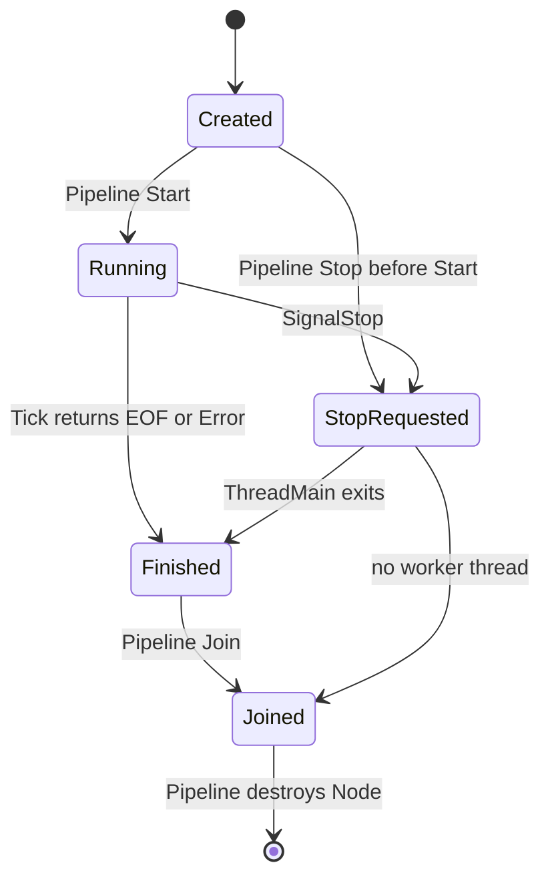
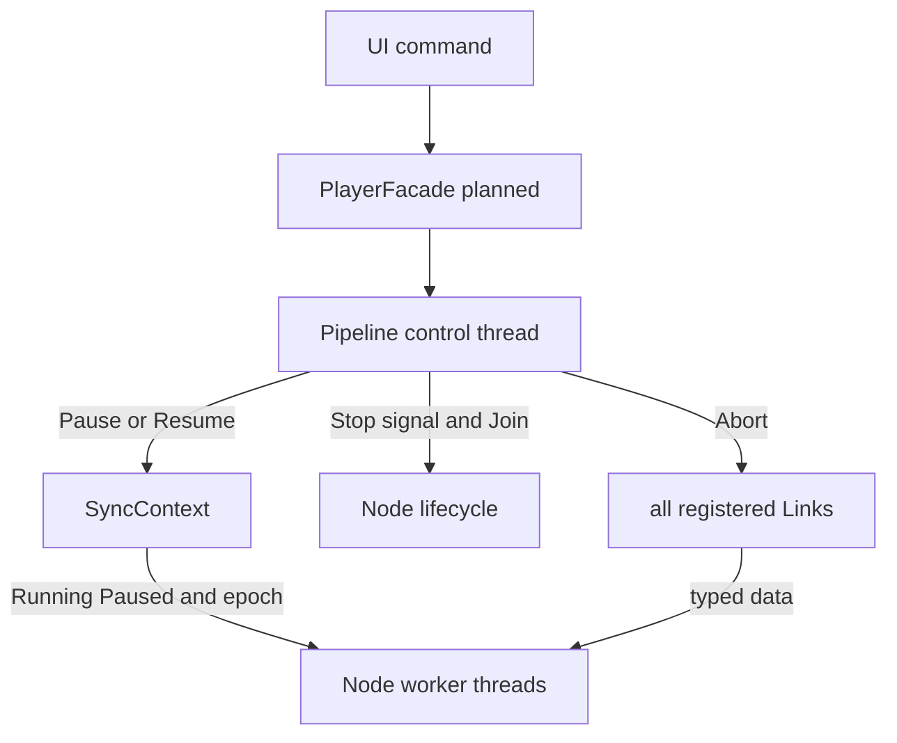
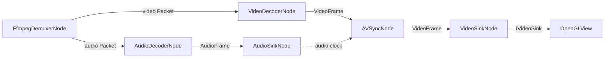

# AI Media Player 架构设计文档

> 本文说明新播放器的目标架构，以及正式仓库当前已经落地的部分。
> 当前实现以 `mediacore/src/` 和 `app/` 为准，里程碑状态以 `DEVELOPMENT_PLAN.md` 为准。
> `_review_temp/` 只用于评审，不能作为功能完成或测试通过的依据。

## 0. 项目范围和当前状态

本项目是播放器。新增模块必须进入本地或网络播放流程，并能通过固定输入、明确指标和可复现测试验证。独立实现但无法服务播放流程的协议、发送端算法或演示代码，不属于本项目主线。

### 0.1 唯一产品主线

从当前 D9 开始，后续开发严格按以下依赖顺序推进。D10 是已经完成的独立 DTO 里程碑，不表示 D9 已经通过验收：

1. 稳定 DAG；
2. 本地软件播放器；
3. 音频与同步；
4. Seek、EOF 和错误闭环；
5. 录制；
6. VA-API 与零拷贝；
7. 色彩管理；
8. HTTP 网络播放；
9. RTP 接收与 Jitter Buffer；
10. 可复现弱网测试。

后一阶段不能用来绕过前一阶段的验收。网络播放复用已经稳定的解复用、解码、同步和输出节点；硬解复用软件播放已经确定的媒体语义和控制协议。

### 0.2 非目标和条件能力

- 当前项目不实现 RTSP/RTMP、完整 WebRTC、SRT 或 QUIC 协议栈，也不实现 RTP 发送、Pacer、GCC/BBR、发送端动态码率等发送侧拥塞控制。
- RTP 第一版是 H.264 播放接收端。RTCP、SRTP 和 RTP 音频不进入首个 RTP 播放闭环。
- FEC 不属于默认 RTP 数据流，也不是任何主线里程碑的完成条件。只有协议、线格式、发送端行为和可复现测试向量全部明确后，才作为独立事项评估。
- GOP Cache 不属于默认 RTP 数据流。只有暖启动或重连指标证明需要缓存完整 Access Unit 时，才单独评估其收益和内存上限。
- HTTP 首先使用 FFmpeg 的 URL 输入、超时和 interrupt callback。只有对比测试证明它无法满足 Range、缓存观测或取消需求时，才增加自定义 HTTP Source。
- 不把技术调研或机制白皮书作为功能交付；完成状态必须由正式代码、构建和测试证明。

### 0.3 当前状态

| 范围 | 状态 | 说明 |
|---|---|---|
| UI、`IPlayer`、`IVideoSink`、`StubPlayer` | 已有可运行闭环 | 当前画面来自 `StubPlayer` 测试帧，不是真实媒体解码结果 |
| `ThreadSafeQueue`、`Link`、`INodeBase`、`INode`、`SyncContext`、`Pipeline` | D9 进行中 | 核心头文件已经进入正式目录，但尚未完成正式 CMake 测试接入和并发验收 |
| `Packet` RAII 与时间戳字段 | D10 已完成 | D10 与 D9 独立，不代表 DAG 生命周期已经验收 |
| `StreamInfo`、`FfmpegDemuxerNode` | D11 未开始 | 正式仓库中尚无对应实现和测试 |
| 本地播放、录制、硬解、色彩、网络与抗弱网 | 未开始 | 均属于后续里程碑 |

## 1. 分层与职责

目标依赖方向如下：

```text
Qt UI
  -> IPlayer / PlayerFacade
      -> Pipeline
          -> INodeBase / INode / 具体 Node
          -> Link<T>
              -> ThreadSafeQueue<T>
          -> SyncContext
```

`PlayerFacade`、真实媒体组图和完整控制状态机将在后续里程碑接入。D9 当前只实现 DAG 生命周期核心。

| 类型 | 负责 | 不负责 |
|---|---|---|
| `IPlayer` | 定义 UI 可见的 Open、Play、Pause、Stop、Seek 等接口 | DAG、线程和队列实现 |
| `PlayerFacade`（规划） | 校验用户命令，创建并调用 `Pipeline`，维护 `PlaybackState` | 直接启停单个 Node，直接修改 `SyncContext` |
| `Pipeline` | 创建并登记 Node/Link，启动、暂停、恢复、停止和 Join 整个 DAG | 具体媒体处理；当前也不包含 Open、Build、Seek |
| `SyncContext` | 保存所有 Node 共享的 Running/Paused 状态和 epoch；实现暂停等待 | Pipeline 生命周期状态、Node/Link 所有权、停止状态 |
| `INodeBase` | 单个 Node 的一次性线程生命周期、固定 `ThreadMain`、停止标志、退出原因和异常边界 | 完整拓扑、Link 的统一中止、媒体会话状态 |
| `INode<InT, OutT>` | 为零或一个输入端口、零或一个输出端口提供强类型连接和收发辅助函数 | 多输入、多输出拓扑；完整图生命周期 |
| 具体 Node（规划） | 在 `Tick()` 中完成一次读取、处理或发送；按需要中断外部阻塞 I/O | 创建 Link、遍历 DAG、Join 自身线程 |
| `Link<T>` | 包装强类型有界队列，提供 Send、Receive、Close、Abort | 决定正常 EOF 或立即停止的时机 |
| `ThreadSafeQueue<T>` | 实现有界阻塞、背压、Close 排空和 Abort 中止 | DAG 类型关系和媒体语义 |

## 2. 四个状态域

这些状态属于不同对象，不能合并成一个全局枚举。

| 状态域 | 所有者 | 当前或规划值 | 写入方 |
|---|---|---|---|
| `PlaybackState` | `PlayerFacade`（规划） | Idle/Opening/Playing/Paused/Stopped/Error | Player 控制线程 |
| `PipelineState` | `Pipeline` | Building/Starting/Running/Stopping/Stopped | Pipeline 控制线程 |
| `PipelineRunState` + epoch | `SyncContext` | Running/Paused；Seek 世代号 | 仅 `Pipeline` |
| `NodeState` | `INodeBase` | Created/Running/StopRequested/Finished/Joined | Pipeline 控制线程和 Node 工作线程 |

### 2.1 为什么 `PipelineState` 不是 atomic

`CreateLink`、`EmplaceNode`、`Start`、`Pause`、`Resume`、`Stop` 和 `Pipeline` 析构必须由同一个控制线程串行调用。`PipelineState` 与 `nodes_`、`links_`、停止过程共同组成一次完整状态转换，仅把一个枚举改成 atomic 不能让这些复合操作支持并发调用。

D15 接入 UI 后，如果命令可能来自不同线程，应由 Player 的控制执行器先串行化，再调用 `Pipeline`。Node 工作线程确实需要读取的 `NodeState`、停止标志、`PipelineRunState` 和 epoch 继续使用 atomic。

### 2.2 为什么暂停不增加 `PipelineState::kPaused`

`PipelineState::kRunning` 表示 DAG 已启动且尚未停止。DAG 内的工作线程当前运行还是暂停，由 `SyncContext::PipelineRunState` 表示。因此：

- `Pause()` 成功后，`PipelineState` 仍为 `kRunning`，`PipelineRunState` 变为 `kPaused`；
- `Resume()` 成功后，`PipelineState` 仍为 `kRunning`，`PipelineRunState` 变为 `kRunning`；
- 重复的 Pause/Resume/Pause 不需要重建 Node 或 Link；
- Stop 是一次性生命周期结束，完成后不能重新 Start 同一张图。

这套逻辑已经写入代码，但重复暂停恢复和并发边界仍需 D9 正式测试验证。

## 3. 所有权和生命周期

```text
PlayerFacade（规划）
  -> unique_ptr<Pipeline>
       -> vector<unique_ptr<INodeBase>>
       -> vector<shared_ptr<ILinkControl>>
       -> shared_ptr<SyncContext>

Node A -> shared_ptr<Link<T>> <- Node B
Node N -> shared_ptr<SyncContext> <- Pipeline
```

| 对象 | 创建者 | 持有方式 | 销毁条件 |
|---|---|---|---|
| `Pipeline` | 未来由 `PlayerFacade` 创建 | `unique_ptr` | 已完成 Stop/Join 后销毁 |
| Node | `Pipeline::EmplaceNode` | Pipeline 独占 `unique_ptr` | 该 Node 线程已经 Join |
| Link | `Pipeline::CreateLink` | Pipeline 和连接该边的 Node 共享 `shared_ptr` | 所有持有者释放后销毁 |
| `SyncContext` | `Pipeline` 构造函数 | Pipeline 和全部 Node 共享 `shared_ptr` | Node 和 Pipeline 全部释放后销毁 |
| `ThreadSafeQueue` | 随 `Link<T>` 构造 | `Link<T>` 的值成员 | 随 Link 销毁 |

硬约束：Node 必须由 Pipeline 统一停止并 Join 后才能析构。

`INodeBase` 析构函数不会发起停止或 Join，只检查线程已经不可 Join。`Pipeline` 析构函数当前会调用 `Stop()`，但正常控制路径仍应显式停止 Pipeline，并检查停止结果。若仍有 Node 线程未 Join，不能继续销毁 DAG。

`Pipeline` 不是进程级单例。一个 Player 实例通常独占一条 Pipeline；多个 Player 可以各自拥有独立 Pipeline 和 `SyncContext`。

## 4. 组图规则

### 4.1 Link 的创建和连接

Link 必须通过 `Pipeline::CreateLink<T>(capacity)` 创建。Pipeline 同时把它登记到 `links_`，这样 Stop 时可以通过 `ILinkControl` 统一 Abort 所有不同类型的 Link。

Node 只接收已经创建好的 `shared_ptr<Link<T>>`：

```cpp
auto packets = pipeline.CreateLink<Packet>(60);

auto& source = pipeline.EmplaceNode<SourceNode>(/* SourceNode 参数 */);
auto& sink = pipeline.EmplaceNode<SinkNode>(/* SinkNode 参数 */);

source.ConnectOutput(packets);
sink.ConnectInput(packets);
```

`EmplaceNode<NodeT>(args...)` 实际构造：

```cpp
NodeT(sync_context, args...)
```

Pipeline 自动注入 `SyncContext`，调用者只传具体 Node 的其他构造参数。返回的引用只用于组图或查询，不拥有 Node，也不能超过 Pipeline 的生命周期。

### 4.2 Node 登记顺序

当前 `Pipeline` 不分析 Link 连接关系，也不计算拓扑排序。调用者必须按 Source 到 Sink 的拓扑顺序调用 `EmplaceNode()`。`Start()` 反向遍历 `nodes_`，从而按 Sink 到 Source 启动，保证消费者先于生产者运行。

分支和汇聚图同样必须满足上述登记顺序。D9 测试需要验证实际启动顺序；在实现自动拓扑排序前，错误登记顺序不会被框架自动发现。

### 4.3 Link 的共享范围

一条 Link 默认连接一个生产者和一个消费者。上游 Node、下游 Node 和 Pipeline 可以同时持有同一个 Link 的 `shared_ptr`。一个 Node 也可以持有多条不同的 Link。

两个消费者不能通过竞争同一条队列实现广播。需要多播时，应由 Tee 向多条 Link 分别发送。

## 5. Node 线程协议

`INodeBase::ThreadMain` 是固定的非虚函数。具体 Node 只实现 `Tick()`，以及需要时实现外部 I/O 中断钩子。

```text
循环开始
  -> WaitWhilePaused(Node 的停止谓词)
  -> 如果已收到停止请求，结束线程
  -> 调用一次 Tick()
       Continue     -> 下一轮
       EndOfStream  -> 记录 EOF 并结束
       Stopped      -> 记录停止并结束
       Error        -> 记录错误并结束
  -> 未处理 C++ 异常由 ThreadMain 捕获并记录
  -> 状态变为 Finished
```

`Tick()` 不得创建自己的长期工作线程。阻塞在外部 I/O 的 Node 必须让该阻塞操作支持取消，并在 `OnInterruptBlockingIo()` 中只执行线程安全、幂等的中断动作。该钩子可能与 `Tick()` 并发，不能释放 `Tick()` 仍可能使用的媒体对象。

Node 生命周期如下：



暂停不是 `NodeState`。暂停期间 Node 仍属于已启动生命周期，只是在 `SyncContext` 的条件变量上等待。

## 6. Pipeline 操作

### 6.1 Start

前置条件：

- Pipeline 处于 `kBuilding`；
- 至少登记了一个 Node；
- Node 按 Source 到 Sink 排列；
- 所有端口已完成连接。

执行过程：

1. Pipeline 进入 `kStarting`；
2. 按 `nodes_` 反向顺序启动 Node；
3. 全部成功后进入 `kRunning`；
4. 任一 Node 启动失败时调用完整 `Stop()` 回收已经启动的线程。

同一 Pipeline 只能 Start 一次。

### 6.2 Pause 和 Resume

`Pause()` 只把共享运行态设为 `kPaused`，不会等待每个 Node 已经进入暂停条件变量。Node 会在当前 `Tick()` 返回并进入下一轮循环时暂停。

因此暂停是协作式的：

- 已在执行的 `Tick()` 不会被强制终止；
- 已阻塞在 Link Send/Receive 或外部 I/O 的 Node，要等阻塞操作返回后才会进入暂停等待；
- `Resume()` 把运行态设回 `kRunning`，并唤醒所有已经登记在暂停条件变量上的 Node。

反复 Pause/Resume 不改变 DAG 对象和 Link 存量。正式验收必须覆盖 Play/Pause/Resume/Pause、暂停时 Stop，以及无空转等待。

### 6.3 Stop

立即停止使用固定的全图协议：

```text
Pipeline::Stop
  1. SignalStop 全部 Node
  2. Abort 全部已登记 Link
  3. InterruptBlockingIo 全部 Node
  4. WakeAllPausedThreads
  5. Join 全部 Node
```

顺序的含义：

1. 先让所有 Node 的停止谓词变为 true；
2. 再让阻塞在空队列 Receive 或满队列 Send 的线程返回；
3. 再请求外部文件、网络或音频 I/O 返回；
4. 最后唤醒暂停条件变量，使等待谓词能观察到停止请求；
5. 所有可能的阻塞都已解除后，统一 Join。

Pipeline 统一遍历 `links_`，Node 不负责在停止时遍历或中止自己的 Link。这避免多输入、多输出 Node 漏掉某条边，也避免停止正确性依赖派生类钩子。

Stop 可以重复调用。只有全部 Node 都完成 Join，Pipeline 才进入 `kStopped`；若仍有线程未 Join，状态保持 `kStopping`，DAG 不允许析构。

当前 Stop 不承诺和 Start、Pause、Resume 并发调用。`stop_in_progress_` 只防止停止钩子同步重入，不是通用并发锁。

## 7. Close、Abort 与 EOF

`Close` 和 `Abort` 处理不同场景：

| 操作 | 后续 Send | 已入队数据 | 阻塞线程 | 用途 |
|---|---|---|---|---|
| `Link::Close()` | 失败 | 下游可以继续 Receive，排空后得到 `nullopt` | 被唤醒并按排空规则返回 | 正常 EOF |
| `Link::Abort()` | 失败 | 立即丢弃 | Send 和 Receive 都被唤醒并失败 | Pipeline 立即停止 |

方向以单个 Node 为参照：

- 输出 Link 的发送方是上游 Node；上游正常结束时调用 `CloseOutput()`，内部关闭输出 Link；
- 输入 Link 的接收方是下游 Node；下游不关闭上游的正常输出，只负责继续 Receive 直至排空；
- Pipeline 站在整张图的控制位置，Stop 时不区分输入端和输出端，而是 Abort 全部已登记 Link。

Abort 不可恢复。Stop 后不能复用原 Link 或重新 Start 原 Pipeline。录制文件需要写完缓存和 trailer，必须在 D23 使用独立的 Drain 协议，不能把立即 Stop 的 Abort 改成 Close。

## 8. 控制权边界



控制规则：

- UI 和具体 Node 不直接修改 `SyncContext`；修改函数是 private，只允许 `Pipeline` 调用；
- `Pipeline::GetSyncContext()` 只返回 `shared_ptr<const SyncContext>`；
- Node 可以读取运行态和 epoch，并在暂停条件变量上等待；
- 具体 Node 不调用自身的 Start、SignalStop、Interrupt 或 Join，这些函数只向 Pipeline 开放；
- Link 的 `Abort()` 当前是公开虚接口，但业务 Node 不应使用它承担全图停止。是否进一步收紧访问权限属于 D9 API 冻结工作。

## 9. 目标播放数据流和实现顺序

以下内容是目标架构，不代表当前已经实现：

### 9.1 本地软件播放



软件视频闭环先于音频、录制和硬解落地。音频接入后以音频设备时钟为主时钟；视频-only 播放使用单调墙钟。Seek、EOF 和错误必须在本地软件播放链中先形成端到端闭环，后续网络源不得重新定义这些语义。

### 9.2 HTTP 网络播放

HTTP 第一版复用 FFmpeg 的协议层：

```text
HTTP URL -> FfmpegDemuxerNode -> software/hardware decode -> sync -> sink
```

`FfmpegDemuxerNode` 必须配置 Open/Read 超时、interrupt callback、有限重连和 Stop 取消。只有基准和故障测试证明 FFmpeg URL 无法满足需求时，才允许引入：

```text
HttpSourceNode -> AVIOContext -> FfmpegDemuxerNode
```

自定义 Source 是有证据后的替代输入层，不是 HTTP 播放的前置条件。

### 9.3 RTP 接收与 Jitter Buffer

默认 RTP 视频输入链固定为：

```text
RtpSource -> JitterBuffer -> H264Depacketizer -> VideoDecoder
```

`RtpSource` 负责可取消的 UDP 接收和 RTP 头解析；`JitterBuffer` 按扩展序列号重排、过滤重复包，并在超时后确定空洞丢失；`H264Depacketizer` 在最终包顺序确定后处理 Single NALU、STAP-A 和 FU-A。解码后复用现有同步和输出节点。

这条默认数据流不包含 FEC 或 GOP Cache。Jitter Buffer 先实现固定窗口和确定性虚拟时钟测试，再根据已测 jitter、rebuffer 和端到端延迟决定是否自适应，不能通过无限增大缓存掩盖丢包。

### 9.4 实现顺序

| 顺序 | 阶段 | 进入下一阶段前必须成立 |
|---|---|---|
| 1 | 稳定 DAG（D9） | 生命周期、背压、Pause/Resume、Stop/Join 和并发测试通过正式验收 |
| 2 | 本地软件播放器（D11-D15） | 本地视频可以 Open、Play、Pause、Resume、Stop 和 Reopen |
| 3 | 音频与同步（D16-D18） | 音频输出可取消，A/V 同步偏差可测量 |
| 4 | Seek、EOF 和错误闭环（D19-D20） | 正常完成、Seek Flush、错误上报和恢复路径可重复验证 |
| 5 | 录制（D21-D23） | 录制分支不拖停播放，Drain 后容器可播放和 Seek |
| 6 | VA-API 与零拷贝（D24-D29） | 硬解正确、可回退，DMA-BUF/EGL 生命周期和性能收益有证据 |
| 7 | 色彩管理（D30-D31） | SDR/HDR 结果可与参考输入比较 |
| 8 | HTTP 网络播放（D32-D34） | FFmpeg URL 基线可播放、可停止、可测量；自定义 Source 经过决策门 |
| 9 | RTP 接收与 Jitter Buffer（D35-D38） | H.264 RTP 在乱序、重复、丢包、断流和重连条件下按明确策略播放；缓存自适应有上下限 |
| 10 | 可复现弱网测试（D39） | HTTP 和 RTP 的固定 trace/profile 能重复产生并比较首帧、rebuffer、延迟、丢包和重连指标 |

D40 只对上述能力执行全量回归、性能记录和文档收口，不是新的产品能力阶段。

`Pipeline::Seek`、媒体探测、自动组图、EOF 汇聚和播放完成事件当前都不存在。epoch 已在 `SyncContext` 和 DTO 中预留，不等于 Seek 已实现。

## 10. D9 验收和剩余风险

D9 仍需完成：

1. 将 DAG 核心显式纳入正式构建覆盖；
2. 使用假 Source、Transform、Sink 建立正式 CTest；
3. 验证正常 Close 排空、空队列 Receive 停止、满队列 Send 停止和暂停中停止；
4. 验证反复 Pause/Resume/Pause、外部 I/O 中断和部分启动失败回滚；
5. 验证重复 Stop、Tick 异常、Node 先 Join 后析构和拓扑启动顺序；
6. 运行普通警告构建、ASan/UBSan 和 TSan，并记录可复现结果。

在这些条件完成前，当前设计仍有以下风险：

- DAG 头文件尚未被正式 target 和测试完整实例化，模板错误可能被普通应用构建漏过；
- Node 登记顺序依赖调用者，Pipeline 目前不验证拓扑；
- 外部阻塞 I/O 能否及时响应取消，需要由真实 Node 和模拟阻塞测试共同验证；
- Pause 只在 Tick 边界生效，长时间 Tick 必须自行支持取消或拆分；
- Link 的 Stop 控制权限尚未由类型系统完全限制；
- EOF、错误和多个分支的完成汇聚要在真实媒体 Pipeline 中另行设计，不能由 `Receive()==nullopt` 单独区分；
- epoch 辅助接口已经存在，但第一个真实消费者尚未实现，Seek 语义没有端到端验证。

## 11. 当前结论

正式仓库已经有 D9 所需的 Queue、Link、Node、SyncContext 和 Pipeline 代码基础，停止职责也已经集中到 Pipeline：先通知全部 Node，再 Abort 全部 Link，再中断外部 I/O、唤醒暂停线程并 Join。

这仍是“实现进行中”，不是“已通过并发验证”。当前应先完成 D9 的编译集成、测试和 Sanitizer 验收；D10 保持现状；D11 的 StreamInfo 和 Demuxer 在 D9 验收后开始开发。
