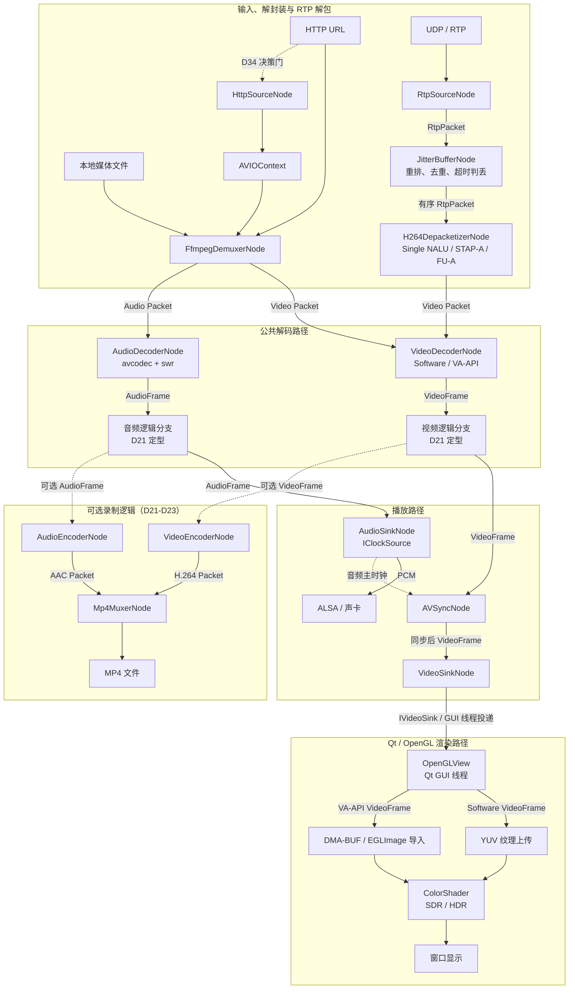

# ai-media-player

基于 FFmpeg + Qt + OpenGL 演进的音视频播放器工程

---

## 项目简介

本项目是一款面向“现代播放器工程能力”打磨的 C++17 音视频播放器。当前正式可运行能力是 Qt UI、`IPlayer`/`IVideoSink` 公共契约、`StubPlayer` 渐变测试帧和 OpenGL 显示闭环；真实媒体解封装、解码、音画同步、录制、硬件零拷贝和网络 QoS 尚未实现。

媒体内核正在重构为**独立线程 + 有界阻塞队列的强类型固定拓扑节点图（DAG）**。仓库已有 `ThreadSafeQueue`、`Link`、`INodeBase`、`SyncContext` 和 D9 `Pipeline` 生命周期代码，D9 测试已经接入正式 CTest。11 个生命周期用例在普通构建、警告构建、ASan/UBSan（当前容器关闭 LeakSanitizer）和 Clang TSan 下通过；根据当前项目决定，LeakSanitizer 暂不执行并按通过处理，D9 已完成。D10 `Packet` RAII、时间戳、flags 和 epoch 保持已完成；D11 `StreamInfo + FfmpegDemuxerNode` 尚未开发。

### 唯一产品路线

从当前 D9 开始，以下是唯一推进顺序，均为目标能力而非当前完成声明。前一阶段未达到可复现验收条件时，不进入后一阶段；D10 是已经完成的独立 DTO 里程碑：

1. **稳定 DAG**：完成 Queue / Link / Node / SyncContext / Pipeline 生命周期、背压、暂停、停止、异常和正式并发测试。
2. **本地软件播放器**：用 FFmpeg 完成 StreamInfo、解封装、软件视频解码、软件渲染和最小播放闭环。
3. **音频与同步**：完成音频解码、ALSA 输出、音频主时钟和视频同步。
4. **Seek / EOF / 错误闭环**：完成 epoch、带内 Flush、正常排空、播放完成事件和结构化错误上报。
5. **录制**：在不修改运行中主 DAG 拓扑的前提下增加 Tee、编码、MP4 Mux 和独立 Drain 语义。
6. **VA-API 与零拷贝**：先验证硬解正确性和软件 fallback，再打通 DMA-BUF / EGLImage，并用数据证明收益。
7. **色彩管理**：依次完成 SDR 矩阵与范围、HDR 识别和 HDR 到 SDR tone mapping。
8. **HTTP 网络播放**：先使用 FFmpeg URL、超时和 interrupt callback 建立可靠基线；只有证据充分时才增加自定义 HTTP Source。
9. **RTP 接收 + Jitter Buffer**：完成可取消 UDP 接收、RTP/H.264 解析、固定重排判丢，再基于指标做自适应。
10. **可复现弱网测试**：用固定 trace、代理或 netem profile 验证首帧、rebuffer、延迟、丢包、重连和队列峰值，不用主观观看代替验收。

### 明确非目标

- 不自写 FLV/MP4 等容器解析器，容器探测和解封装统一交给 FFmpeg。
- RTSP/RTMP、SRT 和 QUIC 不在本项目范围内。
- 不集成完整 WebRTC 协议栈，也不在播放器主线中加入 RTCP、SRTP 或拥塞控制。
- 默认 RTP 路径不包含 FEC。只有协议、线格式、收发端约定和可复现测试数据全部明确后，才单独评估 FEC；它不能阻塞 RTP + Jitter Buffer 主链。
- GOP Cache 不在当前主线中。只有暖启动或重连指标证明需要缓存完整 Access Unit 时，才单独评估。
- FFmpeg HTTP 能满足取消、超时和观测需求时，不增加 `libcurl + AVIOContext` 自定义层。
- 不修改运行中的主 Pipeline 拓扑；录制采用构建时固定分支或独立 Pipeline，最终方案在录制阶段定型。
- 不承诺脱离测试条件的“首帧 <180ms”或零拷贝收益，性能结论必须附输入、环境、时间源和测量数据。

---

## 架构设计

目标架构是**强类型固定拓扑的节点图（DAG）**：媒体模块以 Node 表达，节点之间通过 `Link<T>` 单向传递数据，`Pipeline` 独占图生命周期并通过 `SyncContext` 协调运行门控和 epoch。当前完成度以源码目录树和 [DEVELOPMENT_PLAN.md](./DEVELOPMENT_PLAN.md) 的进度快照为准。

### 1. 源码目录结构

#### 1.1 公共 / 私有边界（PUBLIC vs PRIVATE）

采用 Google C++ Style 分层，**可见性由构建系统强制，而非靠约定**：

| 目录 | 可见性 | 谁能 include | 内容判定标准 |
|------|--------|-------------|-------------|
| `mediacore/include/mediacore/` | `PUBLIC` | `app` 层 + 库自身 | 仅"UI 必须知道"的契约与跨边界 DTO |
| `mediacore/src/` | `PRIVATE` | 仅库自身 | DAG 框架、并发原语、各具体 Node、内部 DTO |

```cmake
target_include_directories(mediacore
    PUBLIC  ${CMAKE_CURRENT_SOURCE_DIR}/include   # 随依赖传播给 app
    PRIVATE ${CMAKE_CURRENT_SOURCE_DIR}/src       # 不传播，app 无法 include
)
```

两条硬规则：

1. **公共头以库名 `mediacore` 做前缀目录**：`#include "mediacore/iplayer.h"` 防重名冲突（`legacy/` 下同样存在 `iplayer.h`）、来源自明；且安装后 `/usr/include/mediacore/...` 与开发期写法完全一致。
2. **`app` 只允许 include `mediacore/include/mediacore/` 下的公共契约和跨边界 DTO**。私有头放在 `src/` 后，app 误 include 会**编译期失败**，边界不靠人自觉。

`av_types/` 按可见性一分为二。下表同时包含当前 DTO 和后续规划，是否已经落地以 1.2 节的状态标记为准：

| DTO | 位置 | 理由 |
|-----|------|------|
| `video_frame.h` / `frame_size.h` | PUBLIC | 视频帧要跨内核边界交给 `OpenGLView` 上传纹理 |
| `av_frame_flag.h` | PUBLIC（待 D12 收口） | 当前 `Packet` 使用它，而 `VideoFrame` 仍有另一套 `FrameFlag`；D12 统一协议后重新确认可见性 |
| `packet.h` / `stream_info.h` / `byte_chunk.h` / `audio_frame.h` | PRIVATE | 只在 DAG 节点之间流动，UI 永不触碰 |

#### 1.2 目录树

图例：`✅` 已实现　`🔄` 进行中　`🔶` 部分实现　`⬜` 规划中（尚未落地）

```
ai-media-player/
├── CMakeLists.txt                             ✅
├── build.sh / conanfile.py                    ✅
├── AI_ENGINEERING_STANDARD.md                 ✅ AI 协作开发规范
├── ARCHITECTURE.md / DEVELOPMENT_PLAN.md      ✅
├── legacy/                                    ✅ 旧实现归档（只读，不作新架构设计或迁移依据）
│
├── mediacore/                                 # 核心媒体引擎静态库（libmediacore）
│   ├── include/mediacore/                     # ===== PUBLIC：app 可见的全部内容 =====
│   │   ├── iplayer.h                          ✅ Facade 接口（UI 唯一控制入口）
│   │   ├── ivideo_sink.h                      ✅ UI 渲染注入点
│   │   ├── playback_state.h                   ✅ UI 可见的播放状态枚举
│   │   ├── player_factory.h                   ✅ CreatePlayer() 工厂
│   │   ├── igl_context.h                      ⬜ 共享 GL 上下文接口（硬解零拷贝阶段）
│   │   ├── logger.h                           ⬜ spdlog 封装
│   │   └── av_types/                          # 跨边界 DTO（仅 UI 需要的）
│   │       ├── frame_size.h                   ✅ 具名宽高，防相邻 int 参数写反
│   │       ├── av_frame_flag.h                ✅ 帧标志位（kKeyFrame/kEOF/kFlush）
│   │       └── video_frame.h                  🔶 Software 基础已实现；契约完善待 D12，Hardware 待 D25
│   │
│   └── src/                                   # ===== PRIVATE：内部实现 =====
│       ├── av_types/                          # 内部 DTO（UI 不可见）
│       │   ├── packet.h/.cpp                  ✅ RAII 包 AVPacket* + pts_us/dts_us/epoch/flags
│       │   ├── audio_frame.h                  ⬜ PCM 帧
│       │   ├── stream_info.h                  ⬜ D11：VideoStreamInfo / AudioStreamInfo / MediaInfo / Rational
│       │   └── byte_chunk.h                   ⬜ D34 决策门通过后供自定义 HTTP Source 使用
│       │
│       ├── core/                              # DAG 框架
│       │   ├── inode.h                        ✅ D9：线程循环、TickResult、停止原因和端口便利模板
│       │   ├── link.h                         ✅ D9：强类型数据边 + Pipeline 类型擦除控制接口
│       │   ├── sync_context.h                 ✅ D9：运行/暂停门控 + epoch + 暂停 CV
│       │   ├── stub_player.h/.cpp             🔶 桩 IPlayer（渐变测试帧），真实管线就绪后移除
│       │   ├── player_factory.cpp             ✅ 工厂实现
│       │   ├── pipeline.h                     ✅ D9：组图、Start/Pause/Resume/Stop；Build/Seek 待 D15/D20
│       │   ├── fsm.h/.cpp                     ⬜ 显式状态机（合法跃迁表）
│       │   ├── iclock_source.h                ⬜ 时钟接口 IClockSource
│       │   └── player_facade.h/.cpp           ⬜ 对 UI 的门面（实现 IPlayer，取代 StubPlayer）
│       │
│       ├── utils/
│       │   ├── thread_safe_queue.h            ✅ 泛型有界阻塞队列（双 CV 背压 + Close/Abort）
│       │   └── logger.cpp                     ⬜ spdlog 实现
│       │
│       ├── demux/
│       │   └── ffmpeg_demuxer_node.h/.cpp     ⬜ D11：本地 path 探测与读包；D32 验证 HTTP URL
│       │
│       ├── decode/
│       │   ├── video_decoder_node.h/.cpp      ⬜ D13 软解 / D26 VA-API 硬解
│       │   ├── audio_decoder_node.h/.cpp      ⬜ D16：avcodec + swr 重采样
│       │   └── hw_device_context.h/.cpp       ⬜ D25：硬件上下文和帧所有权契约
│       │
│       ├── sync/
│       │   └── av_sync_node.h/.cpp            ⬜ D18：音频主时钟与视频墙钟 fallback
│       │
│       ├── sink/                              # 终端输出层（DAG 汇聚点，与 source/ 对称）
│       │   ├── video_sink_node.h/.cpp         ⬜ D14：把帧投递给 IVideoSink / OpenGLView
│       │   ├── audio_sink_node.h/.cpp         ⬜ D17：消费 PCM，兼 IClockSource（音频主时钟）
│       │   ├── iaudio_sink.h                  ⬜ D17：音频后端抽象
│       │   └── alsa_audio_sink.h/.cpp         ⬜ D17：ALSA 实现（libasound / snd_pcm_writei）
│       │
│       ├── source/                            # 数据源层
│       │   ├── http_source_node.h/.cpp        ⬜ D34 决策门通过后才实现
│       │   └── rtp_source_node.h/.cpp         ⬜ D35：可取消 UDP 接收 + RTP 头解析
│       │
│       ├── network/                           # QoS 抗弱网层（仅网络源接入）
│       │   ├── rtp_depacketizer_node.h/.cpp   ⬜ D35/D37：FU-A / STAP-A 组帧
│       │   └── jitter_buffer_node.h/.cpp      ⬜ D36/D38：固定重排、恢复和有界自适应
│       │
│       ├── filter/
│       │   └── tee_node.h                     ⬜ 帧多播（录制分支，shared_ptr 零拷贝转发）
│       │
│       ├── encode/
│       │   ├── video_encoder_node.h/.cpp      ⬜ CBR/CRF/CQP 码率控制
│       │   ├── audio_encoder_node.h/.cpp      ⬜ AAC FLTP 编码
│       │   └── rate_control_config.h          ⬜
│       │
│       ├── mux/
│       │   └── mp4_muxer_node.h/.cpp          ⬜ av_interleaved_write_frame 交错写盘
│       │
│       └── qos/
│           └── qos_monitor.h/.cpp             ⬜ D33：指标定义与采样基线
│
├── app/                                       # 桌面应用层（Qt GUI 前端）
    ├── main.cpp                               ✅ 创建 Qt 事件循环 + 工厂造 IPlayer
    ├── player_widget.h/.cpp                   ✅ 持 IPlayer*（非拥有），翻译 UI 信号为业务调用
    ├── controller_widget.h/.cpp               🔶 播放/暂停 + 进度条；时间显示与 QoS 指标待补
    ├── opengl_view.h/.cpp                     🔶 StubPlayer 软件测试帧可显示；真实帧接入待 D14
    ├── main_window.h/.cpp                     ⬜ 顶层窗口（当前 PlayerWidget 直接作顶层窗口）
    └── render/
        ├── sw_texture_uploader.h/.cpp         ⬜ D14：软件 YUV 三平面上传（从 opengl_view 抽出）
        ├── hw_texture_importer.h/.cpp         ⬜ D28：DMA-BUF / EGLImage 导入
        └── color_shader.h                     ⬜ D30/D31：SDR 色彩管理 + HDR Tone Mapping

└── tests/                                      # 正式测试目录
    └── dag/                                    # D9 DAG 生命周期和并发测试
        ├── CMakeLists.txt
        └── d9_dag_lifecycle_test.cpp
```

> **当前状态**：D9 生命周期代码和 11 个正式 CTest 用例已经进入仓库。普通构建、警告构建、ASan/UBSan（当前容器关闭 LeakSanitizer）和 Clang TSan 均已验证；根据当前项目决定，LeakSanitizer 暂不执行并按通过处理，D9 已完成。D10 `Packet` 保持已完成；D11 尚未开始，仓库中不存在 `stream_info.h`、`ffmpeg_demuxer_node.h/.cpp` 或其他真实媒体 Node。

以下 2-6 节描述目标架构和拟定数据流，不代表对应类或端到端能力已经实现；里程碑状态以 `DEVELOPMENT_PLAN.md` 为准。

### 2. 目标类继承与组合树

```
IPlayer (Facade 接口)
└── PlayerFacade
    ├── FSM (显式状态机，合法跃迁表)
    └── Pipeline
        ├── shared_ptr<SyncContext>                         (Pipeline 修改，Node 只读)
        ├── vector<shared_ptr<ILinkControl>>                (停止时统一 Abort)
        └── vector<unique_ptr<INodeBase>>
            ├── HttpSourceNode : INode<NoPort, ByteChunk>     (仅在 D34 决策门通过后)
            ├── RtpSourceNode : INode<NoPort, RtpPacket>
            ├── JitterBufferNode<RtpPacket, RtpPacket>        (仅网络源)
            ├── H264DepacketizerNode<RtpPacket, Packet>       (仅网络源)
            ├── FfmpegDemuxerNode : INodeBase                 (video / audio 双输出)
            ├── INode<Packet, VideoFrame>
            │   └── VideoDecoderNode (sw / VA-API，持 HwDeviceContext)
            ├── INode<Packet, AudioFrame>
            │   └── AudioDecoderNode
            ├── TeeNode<T>                                    (多输出：主路径 / 录制)
            ├── AVSyncNode (依赖 IClockSource)
            ├── VideoEncoderNode : INode<VideoFrame, Packet>
            ├── AudioEncoderNode : INode<AudioFrame, Packet>
            ├── Mp4MuxerNode : INodeBase                      (video / audio 双输入)
            ├── VideoSinkNode : INode<VideoFrame, NoPort>     (→ IVideoSink / OpenGLView)
            └── AudioSinkNode : INode<AudioFrame, NoPort>     (兼 IClockSource)
```

### 3. 目标主播放管线（含录制分支）



- 本地文件、HTTP 和 RTP 是可替换的输入拓扑，不表示同一个 Pipeline 同时启用全部输入。
- HTTP 默认由 `FfmpegDemuxerNode(url)` 直接读取；虚线的 `HttpSourceNode + AVIOContext` 只在 D34 决策门通过后启用。
- RTP 直接在解包后产生 `Video Packet`，不经过 `FfmpegDemuxerNode`；第一版只支持 H.264 视频，默认路径不包含 FEC 或 GOP Cache。
- 录制虚线只表示逻辑数据去向。D21 仍需在“构建时固定分支”和“独立录制 Pipeline”之间定型，不修改运行中的主 Pipeline 拓扑。
- `AudioSinkNode` 通过 `IClockSource` 向 `AVSyncNode` 提供音频主时钟；video-only 播放使用单调时钟。
- D26 先使用 `av_hwframe_transfer_data` 将 VA-API 帧转为软件帧验证硬解正确性；D27-D29 再启用图中的 DMA-BUF / EGLImage 路径，不支持时回退到软件路径。
- Node 媒体处理在各自工作线程中执行；`OpenGLView`、纹理上传、EGLImage 导入和绘制只在 Qt GUI 线程执行。

### 4. 目标节点规格

| 节点 | 输入类型 | 输出类型 | 主要动作 | 线程 |
|------|---------|---------|---------|-----|
| **HttpSourceNode** | – | `ByteChunk` | libcurl 流式 GET，支持 Range | 自有 |
| **RtpSourceNode** | – | `RtpPacket` | UDP recv，解析 RTP 头（seq/ts/marker） | 自有 |
| **JitterBufferNode** | `RtpPacket` | `RtpPacket` | seq 重排、超时判丢、后续自适应深度 | 自有 |
| **H264DepacketizerNode** | `RtpPacket` | `Packet` | H.264 FU-A / STAP-A 组装完整 Access Unit | 自有 |
| **FfmpegDemuxerNode** | path / URL（D34 后可选 `ByteChunk`） | `Packet`×2 | libavformat 探测与读包，打 epoch 戳 | 自有 |
| **VideoDecoderNode** | `Packet` | `VideoFrame` | sw: avcodec / hw: VA-API 显存帧 | 自有 |
| **AudioDecoderNode** | `Packet` | `AudioFrame` | avcodec + swr 重采样 | 自有 |
| **TeeNode\<T\>** | `T` | `T`×N | `shared_ptr` 复制多播（可开关） | 自有 |
| **AVSyncNode** | `VideoFrame` | `VideoFrame` | 根据音频主时钟决定等待、发送或丢帧；偏差阈值由测试确定 | 自有 |
| **VideoEncoderNode** | `VideoFrame` | `Packet` | x264 + CBR/CRF/CQP 码率控制 | 自有 |
| **AudioEncoderNode** | `AudioFrame` | `Packet` | AAC FLTP 编码 | 自有 |
| **Mp4MuxerNode** | `Packet`×2 | – | `av_interleaved_write_frame` | 自有 |
| **VideoSinkNode** | `VideoFrame` | – | 调 `IVideoSink::OnReceiveVideoFrame` | 自有 |
| **AudioSinkNode** | `AudioFrame` | – | 经 `IAudioSink`(AlsaAudioSink) `snd_pcm_writei` 投递 PCM，维护音频主时钟 | 自有 |

### 5. 目标数据类型流转链

```
本地路径 / HTTP URL -> Demux ----------------------------------+
                                                               |
RTP -> Jitter -> H264Depacketizer -----------------------------+
                                                               v
压缩包 Packet { AVPacket*, codec_id, pts_us, dts_us, frame_kind, flags, stream, epoch }
   │
   ▼ Decode 解压（软解 or VA-API 硬解）
未压缩帧          VideoFrame { color_space, color_trc, color_range, flags, epoch, ... }
                              ├─ Software variant: data[3] + linesize[3] + buffer_（紧凑 YUV）
                              └─ Hardware variant: AVBufferRef* + DMA-BUF fd + hw_type
                  AudioFrame { AVFrame*, pts_us, sample_rate, channels }
   │
   ├──→ 编码分支：重新变回 Packet（H264 / AAC）→ Mux 写盘
   │
   └──→ 渲染分支：
        ├─ Software variant → glTexSubImage2D 三平面上传 → GL Texture
        └─ Hardware variant → EGLImage 零拷贝导入 → GL Texture
        Audio → PCM bytes → AudioSinkNode → ALSA (snd_pcm_writei) → 声卡
```

要点：

- **`ByteChunk`**：仅在 D34 决策门通过、确实需要自定义 Source + AVIO 时引入；D11 先使用 FFmpeg 的本地 path，D32 再验证 HTTP URL。
- **`Packet`**：保留 `AVPacket*` 内核（供下游 libavcodec），携带业务级元信息（`codec_id`/`pts_us`/`dts_us`/`frame_kind`/`flags`/`stream`）以及 **`epoch`**（Seek 世代号）。
- **`VideoFrame`** 为 sum type：`Software` 携带紧凑 YUV buffer；`Hardware` 携带 `AVBufferRef*` + DMA-BUF fd，使零拷贝与软件路径共用同一条管线；额外携带 `color_space/color_trc/color_range` 供 GLSL 色彩管线动态选择矩阵与 Tone Mapping。
- **`AudioFrame`** 保持轻包装，重采样/通道布局在 `AudioDecoderNode` 内消化。

### 6. 目标控制信令流

控制接口由同一个 Pipeline 控制线程串行调用。`Pipeline` 是 `SyncContext` 修改接口的唯一调用者；Node 和外部对象只读取运行态与 epoch。Stop 使用独立的 Node 停止标志，不能用 `SyncContext` 的运行/暂停状态代替生命周期停止协议。

```
UI (Qt 主线程)
  │ Play / Pause / Stop / Seek
  ▼
PlayerFacade → FSM.Dispatch(event)  （校验合法跃迁）
  │
  ├─ Pause / Resume：调用 Pipeline::Pause / Resume
  │     Pipeline 修改 SyncContext 的运行门控；Node 在 ThreadMain 中 WaitWhilePaused
  │
  ├─ Stop：Pipeline 按固定阶段停止整张图
  │     SignalStop(all nodes) → Abort(all links) → InterruptBlockingIo
  │     → WakeAllPausedThreads → Join(all nodes)
  │
  └─ Seek（D20）：由 Pipeline 递增 SyncContext epoch
        │
        ▼
     Source/Demuxer 物理重定位到目标位置，此后产出的 Packet/Frame 均打上"新 epoch"
        │
        ▼
     各节点在处理每个数据项时比较 item.epoch 与全局 epoch：
        item.epoch < 当前 epoch  →  陈旧数据（seek 前遗留），无条件丢弃
        item.epoch == 当前 epoch →  正常处理
```

- **atomic epoch（带外世代号）**：D20 的目标是由 Pipeline 递增 epoch，使 Seek 前产生的队列存量和“在飞”数据可被 Node 判定为过期；epoch 不能替代 Demuxer/Decoder/音频设备的有序 Flush。
- **Flush**：D20 Seek 后由 Demuxer 在新位置数据之前注入有序的 `kFlush`，Decoder 和音频设备据此清理内部状态。
- **正常 EOF**：媒体协议可先发送 `kEOF` 供 Decoder drain，随后 Node 的 `CloseOutputs()` 关闭其输出 Link；底层 `Link::Close()` 禁止继续 Send，但允许下游 Receive 排空；队列耗尽后 Receive 返回 `nullopt`。
- **立即 Stop**：Pipeline 调用 `Link::Abort()`，唤醒收发双方并丢弃存量，不能与正常 EOF 或录制 Drain 混用。

---

## 目标技术栈

| 技术领域 | 选型方案 | 在播放器中的用途 |
|----------|----------|---------|
| 核心开发语言 | C++17（Google C++ Style Guide） | 媒体内核与桌面应用实现 |
| 媒体处理框架 | FFmpeg（libavcodec / libavformat / libavutil / libswscale / libswresample） | 解封装、解码、像素转换和音频重采样 |
| 硬件解码 | VA-API（`av_hwdevice_ctx` + `AV_PIX_FMT_VAAPI` + `get_format` 回调） | 降低视频解码的 CPU 负载 |
| 零拷贝互操作 | `vaExportSurfaceHandle` → DMA-BUF fd → `eglCreateImageKHR` → `glEGLImageTargetTexture2DOES` | 将硬件帧直接导入渲染路径 |
| 视频渲染引擎 | OpenGL 3.3 Core / EGL | 软件帧上传、硬件帧导入和显示 |
| 色彩管线 | GLSL：BT.601/709/2020 矩阵动态切换 + PQ EOTF 反变换 + Reinhard Tone Mapping | 按媒体元数据正确显示 SDR/HDR 内容 |
| 音频后端 | ALSA（libasound）原生 PCM 投递；`IAudioSink` 抽象（可切 QtAudioSink / PipeWire）；兼音频主时钟 IClockSource | 音频输出和 A/V 同步主时钟 |
| 并发模型 | 独立线程 + `std::condition_variable` 有界阻塞队列（背压防 OOM）+ atomic epoch | 节点调度、背压、暂停和 Seek 数据过期 |
| 网络拉流 | FFmpeg HTTP 基线；D34 决策门通过后可选 libcurl；原生 UDP + RTP | HTTP 和 RTP 播放输入 |
| 抗弱网 QoS | Jitter Buffer（seq 重排/空洞检测/有界自适应）+ 可复现弱网 profile | RTP 重排、恢复和量化验收 |
| 界面框架 | Qt 6.x | 播放控制和视频窗口 |
| 日志 | spdlog | 运行诊断与错误定位 |
| 构建工具 | CMake 3.23+ | 构建应用、媒体库和测试 |
| 依赖管理 | Conan 2 | 管理第三方库版本 |
| 主开发环境 | Ubuntu 24.04 | 软件播放和 VA-API/EGL 验证 |
| 版本控制 | GitLab | 代码和文档变更管理 |

---

## 环境搭建

### 依赖安装（Ubuntu 24.04）

```bash
# 更新软件源
sudo apt update && sudo apt upgrade -y

# Qt 6 开发套件
sudo apt install -y qt6-base-dev qt6-multimedia-dev qt6-tools-dev

# OpenGL / EGL 开发环境（含硬件解码零拷贝所需的 EGL 头）
sudo apt install -y libgl1-mesa-dev libegl1-mesa-dev libglu1-mesa-dev

# VA-API 硬件解码运行时与开发头 + DMA-BUF 支持
sudo apt install -y vainfo libva-dev libva-drm2 libdrm-dev

# 可选：仅 D34 决策门通过后用于自定义 HTTP Source
sudo apt install -y libcurl4-openssl-dev

# 音频输出（ALSA 原生 PCM 投递）
sudo apt install -y libasound2-dev

# 构建工具与编译器
sudo apt install -y cmake build-essential gdb git pkg-config

# 验证 VA-API 硬件解码能力（应能列出 H264/HEVC 的 VLD 解码入口）
vainfo
```

> FFmpeg / spdlog / stb / glm 由 Conan2 管理；ALSA 走系统包 `libasound2-dev`（非 Conan）。

---

## 编译与运行

```bash
# 1. 克隆项目
git clone https://git.cpptrain.top/zhanmeng/ai-media-player.git
cd ai-media-player

# 2. 一键构建（默认 RelWithDebInfo，可传 Release / Debug）
./build.sh

# 3. 运行
./build/RelWithDebInfo/ai_media_player
```

### D9 DAG 测试

测试位于正式目录 `tests/dag/`，直接包含 `mediacore/src` 的当前实现，不依赖
`_review_temp/`。没有 FFmpeg 或 Qt 环境时，可以只构建 DAG 测试：

```bash
cmake -S . -B /tmp/ai-media-player-d9 \
      -DAI_MEDIA_PLAYER_BUILD_MEDIACORE=OFF \
      -DAI_MEDIA_PLAYER_BUILD_APP=OFF \
      -DBUILD_TESTING=ON
cmake --build /tmp/ai-media-player-d9 --parallel 2
ctest --test-dir /tmp/ai-media-player-d9 --output-on-failure
```

普通构建、ASan/UBSan 和 TSan 应使用不同的构建目录。当前容器不能运行
LeakSanitizer；根据当前项目决定，本轮不执行该项并按测试通过处理。以后在不受限主机
或 CI 中运行时，它可以作为额外的泄漏检查。

---

## 文档导航

| 文档 | 说明 |
|-----|------|
| [README.md](./README.md) | 项目总览与架构设计（本文件） |
| [ARCHITECTURE.md](./ARCHITECTURE.md) | 当前 DAG 生命周期协议、所有权和目标数据流 |
| [DEVELOPMENT_PLAN.md](./DEVELOPMENT_PLAN.md) | 里程碑驱动的播放器重构与演进计划 |
| [AI_ENGINEERING_STANDARD.md](./AI_ENGINEERING_STANDARD.md) | 工程代码与协作规范 |
| [tests/dag/README.md](./tests/dag/README.md) | D9 DAG 生命周期测试说明和运行方法 |

---

## 开发规范

### 一、分支管理规范

| 分支类型 | 命名规范 | 用途说明 |
|----------|----------|----------|
| 主分支 | `main` | 仅存放稳定、可运行的代码，禁止直接提交，仅接受 MR 合并 |
| 重构分支 | `refactor/<scope>` | 架构性改造，如 `refactor/dag` |
| 功能分支 | `feat/<模块名-功能描述>` | 新功能、新模块开发，如 `feat/vaapi-zerocopy` |
| 修复分支 | `fix/<问题描述>` | bug 修复，如 `fix/av-sync-drift` |
| 文档分支 | `docs/<文档内容>` | 文档更新 |

### 二、Commit 提交规范

#### 1. Commit 消息格式

```
<type>(<scope>): <subject>

<body>

<footer>
```

#### 2. type 可选值

| 类型 | 说明 |
|------|------|
| `feat` | 新增功能 |
| `fix` | 修复 Bug |
| `docs` | 文档更新 |
| `style` | 代码格式调整，不影响代码逻辑 |
| `refactor` | 代码重构 |
| `test` | 测试用例 |
| `chore` | 构建过程、依赖库变动 |

#### 3. Commit 示例

```
docs(architecture): 同步 D9 生命周期协议与当前进度

- 按现有 Pipeline API 更新 Start/Pause/Resume/Stop 流程
- 接入 D9 正式 CTest，并记录当前 Sanitizer 验证结果和 LeakSanitizer 环境限制
- 将 D11 Demuxer 与 StreamInfo 标记为未开始
```
