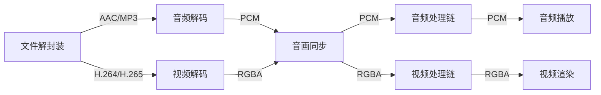

# ai-media-player
AI 驱动的跨平台音视频播放器，基于 FFmpeg + Qt + OpenGL 实现完整媒体处理链路，已完成稳定的基础音视频播放全流程开发

---

## 项目简介
本项目是一款功能完整的 C++ 音视频播放器，遵循标准媒体处理流程，已实现**文件读取、解封装、解码、音画同步、基础音视频效果处理、渲染播放**全链路能力
项目采用模块化架构设计，各模块职责清晰、高度解耦，预留 AI 音视频增强、录制封装等扩展接口，可用于音视频开发学习、播放器原理研究及二次开发

---

## 核心功能模块
### 1. 文件解封装模块
- **输入**：多路复用的音视频文件（支持 MP4、MKV 等主流格式）
- **核心能力**：基于 FFmpeg 提取独立音视频流，解析文件头与元数据，分离音视频流时序信息
- **输出**：解复用后的 AAC/MP3 音频流、H.264/H.265 视频流

### 2. 音频解码模块
- **输入**：文件解封装模块输出的压缩音频流
- **核心能力**：FFmpeg 硬解/软解 AAC/MP3 为未压缩 PCM 格式，完整保留帧时间戳保障音画同步
- **输出**：PCM 格式音频数据，传递至音画同步模块

### 3. 视频解码模块
- **输入**：文件解封装模块输出的压缩视频流
- **核心能力**：FFmpeg 解码 H.264/H.265 为 YUV 原始帧，转换为 RGBA 格式适配 OpenGL 渲染，完整保留帧时间戳
- **输出**：RGBA 格式视频帧，传递至音画同步模块

### 4. 音画同步模块
- **输入**：音频解码模块的 PCM 数据、视频解码模块的 RGBA 帧
- **核心能力**：基于 PTS 时间戳对齐音视频播放顺序，实现毫秒级精准音画同步
- **输出**：同步后的音视频帧，分别传递至音/视频处理链模块

### 5. 音频处理链模块
- **输入**：音画同步模块输出的 PCM 音频帧
- **核心能力**：提供混音、均衡、音量调节等基础音频效果，预留 AI 降噪、人声增强等智能处理扩展接口
- **输出**：处理后音频帧 → 音频播放模块（实时播放）

### 6. 视频处理链模块
- **输入**：音画同步模块输出的 RGBA 视频帧
- **核心能力**：基于 OpenGL 加载纹理，支持黑白滤镜、画面翻转等基础特效，预留 AI 画质增强、人脸识别等扩展接口
- **输出**：处理后视频帧 → 视频渲染模块（实时渲染）

### 7. 音频播放模块
- **输入**：音频处理链模块输出的 PCM 音频帧
- **核心能力**：通过 Qt 音频接口将 PCM 数据输出至系统音频设备，实现低延迟实时播放
- **输出**：音频数据直接输出至播放设备，无后续链路传递

### 8. 视频渲染模块
- **输入**：视频处理链模块输出的 RGBA 视频帧
- **核心能力**：基于 OpenGL 将视频帧作为纹理加载，渲染至 Qt 控件，实现高帧率实时画面输出
- **输出**：视频画面直接渲染至屏幕，无后续链路传递

### 9. 音频编码模块（预留接口）
- 预留录制场景下的音频编码能力接口，可扩展实现 PCM 转 AAC 压缩编码

### 10. 视频编码模块（预留接口）
- 预留录制场景下的视频编码能力接口，可扩展实现 RGBA 转 H.264 压缩编码

### 11. 文件封装模块（预留接口）
- 预留录制场景下的音视频封装能力接口，可扩展实现 MP4 文件封装输出

---

## 项目架构与数据流


---

## 技术栈
| 技术领域 | 选型方案 |
|----------|----------|
| 核心开发语言 | C/C++ 17 |
| 媒体处理框架 | FFmpeg 6.x |
| 界面与跨平台框架 | Qt 6.x |
| 视频渲染引擎 | OpenGL |
| 构建工具 | CMake 3.20+ |
| 主开发环境 | Ubuntu 24.04 |
| 版本控制 | GitLab |

---

## 环境搭建
### 系统要求
- 推荐系统：Ubuntu 24.04 LTS
- 兼容系统：Windows 10+、macOS 12+
- 编译器：GCC 12+ / Clang 18+ / MSVC 2022
- 构建工具：CMake 3.20 及以上版本

### 依赖安装（Ubuntu 24.04 一键安装）
```bash
# 更新软件源
sudo apt update && sudo apt upgrade -y

# 安装 FFmpeg 完整开发库
sudo apt install -y libavformat-dev libavcodec-dev libavutil-dev libswscale-dev libswresample-dev libavfilter-dev

# 安装 Qt 6 开发套件
sudo apt install -y qt6-base-dev qt6-multimedia-dev qt6-opengl-dev qt6-tools-dev

# 安装 OpenGL 开发环境
sudo apt install -y libgl1-mesa-dev libglu1-mesa-dev freeglut3-dev

# 安装构建工具与编译器
sudo apt install -y cmake build-essential gdb git
```

---

## 编译与运行
### 1. 克隆项目
```bash
git clone https://git.cpptrain.top/zhanmeng/ai-media-player.git
cd ai-media-player
```

### 2. 创建构建目录
```bash
mkdir build && cd build
```

### 3. 生成构建文件
```bash 
cmake ..
```

### 4. 编译项目
```bash
# -j 后接CPU核心数，加速编译，如 -j8
make -j8
```

### 5. 运行程序
```bash
./ai-media-player
```

---

## 项目目录结构
```
ai-media-player/
├── 3rdparty/                # 第三方依赖库目录（Git忽略，由Conan管理）
│   └── ffmpeg/              # FFmpeg音视频处理库（唯一必需的第三方依赖）
├── cache/                   # 程序运行缓存目录（Git完全忽略）
│   ├── logs/                # 运行日志文件
│   └── decode_cache/        # 解码临时缓存
├── learn_av/                # 音视频核心业务层（纯C++，完全独立于Qt）
│   ├── include/             # 全局公共头文件（对外暴露的唯一接口）
│   │   ├── igl_context.h    # OpenGL上下文抽象接口
│   │   ├── iplayback_listener.h # 播放事件监听器接口
│   │   ├── iplayer.h        # 播放器核心接口
│   │   └── logger.h         # 日志系统接口
│   └── src/                 # 音视频全链路核心源码
│           ├── core
│           │   ├── av_synchronizer.cpp   # 音画同步器（解决音视频不同步问题）
│           │   ├── av_synchronizer.h
│           │   ├── player.cpp            # 播放器核心实现（状态机管理）
│           │   └── player.h
│           ├── decode                    # 音视频编码
│           │   ├── audio_decoder.cpp
│           │   ├── audio_decoder.h
│           │   ├── interface             # 纯虚接口
│           │   │   ├── iaudio_decoder.h
│           │   │   └── ivideo_decoder.h
│           │   ├── video_decoder.cpp
│           │   └── video_decoder.h
│           ├── define                    # 数据结构定义
│           │   ├── av_error.h
│           │   ├── av_frame.h
│           │   ├── av_packet.h
│           │   └── stream_info.h
│           ├── demux                     # 解复用
│           │   ├── demuxer.cpp
│           │   ├── demuxer.h
│           │   ├── file_reader.cpp
│           │   ├── file_reader.h
│           │   └── interface
│           │       ├── idemuxer.h
│           │       └── ifile_reader.h
│           ├── encode                    # 音视频编码
│           │   ├── audio_encoder.cpp
│           │   ├── audio_encoder.h
│           │   ├── interface
│           │   │   ├── iaudio_encoder.h
│           │   │   └── ivideo_encoder.h
│           │   ├── video_encoder.cpp
│           │   └── video_encoder.h
│           ├── interface                 # 音画同步/音频播放纯虚接口
│           │   ├── iaudio_speaker.h
│           │   └── iav_synchronizer.h
│           ├── mux                       # 复用
│           │   ├── interface
│           │   │   └── imuxer.h
│           │   ├── muxer.cpp
│           │   └── muxer.h
│           ├── output                    # 音频输出
│           │   ├── sdl_audio_speaker.cpp
│           │   └── sdl_audio_speaker.h
│           ├── utils                     # 通用工具类
│           │   ├── logger.cpp
│           │   └── thread_safe_queue.h
│           └── writer                    
│               ├── file_writer.cpp 
│               ├── file_writer.h
│               └── interface
│                   └── ifile_writer.h    
├── qt/                      # 界面交互层（仅负责UI，无任何音视频处理逻辑）
│   ├── main.cpp             # 程序全局入口
│   ├── main_window.cpp      # 主窗口协调器
│   ├── main_window.h
│   └── ui/                  # 细分UI控件
│       ├── controller_widget.cpp # 播放控制面板（播放/暂停/进度条）
│       ├── controller_widget.h
│       ├── opengl_view.cpp  # OpenGL渲染基础类
│       ├── opengl_view.h
│       ├── player_widget.cpp # 视频渲染画布
│       └── player_widget.h
├── resource/                # 静态资源目录（Git管理）
│   ├── icons/               # UI图标资源
│   └── video/               # 测试视频资源
├── CMakeLists.txt           # 项目全局构建配置
├── conanfile.txt            # Conan2第三方依赖管理配置
└── README.md                # 项目说明文档
```

---

## 开发规范
### 一、分支管理规范
| 分支类型 | 命名规范 | 用途说明 |
|----------|----------|----------|
| 主分支 | `main` | 仅存放稳定、可运行的代码，禁止直接提交，仅接受 MR 合并 |
| 功能分支 | `feature/<模块名-功能描述>` | 新功能、新模块开发，如 `feature/demux-mkv-support` |
| 修复分支 | `hotfix/<问题描述>` | 线上紧急bug修复，如 `hotfix/fix-av-sync-drift` |
| 发布分支 | `release/v<版本号>` | 版本发布前的测试、bug修复，如 `release/v1.0.0` |
| 文档分支 | `docs/<文档内容>` | 文档更新、补充，如 `docs/update-architecture-doc` |

### 二、Commit 提交规范
#### 1. Commit 消息格式
```
<type>(<scope>): <subject>

<BLANK LINE>

<body>

<BLANK LINE>

<footer>
```

#### 2. 字段说明
| 字段 | 说明 | 规则要求 |
|------|------|----------|
| `type` | 提交类型 | 必填，用于标识本次提交的核心类型 |
| `scope` | 影响范围 | 可选，描述本次提交影响的模块/组件，如 demux、av_sync、audio_decode |
| `subject` | 提交主题 | 必填，简洁描述本次提交的核心内容，不超过50个字符 |
| `body` | 详细描述 | 可选，详细说明本次提交的目的、实现逻辑、改动点 |
| `footer` | 页脚 | 可选，用于关闭关联Issue、标注不兼容变更 |

#### 3. type 可选值说明
| 类型 | 说明 |
|------|------|
| `feat` | 新增功能 |
| `fix` | 修复Bug |
| `docs` | 文档更新 |
| `style` | 代码格式调整，不影响代码逻辑（空格、缩进、命名规范等） |
| `refactor` | 代码重构，不新增功能、不修复Bug |
| `test` | 测试用例新增、修改 |
| `chore` | 构建过程、辅助工具、依赖库的变动 |

#### 4. Commit 示例
```
feat(demux): 新增 MKV 格式文件解封装支持

- 新增 MKV 格式解析逻辑，适配 Matroska 容器规范
- 补充 MKV 流元数据提取能力
- 兼容多音轨、多字幕轨 MKV 文件

Closes #12
```

```
fix(av_sync): 修复进度条拖动后音画不同步问题

- 修复拖动进度条后 PTS 基准值重置异常的问题
- 优化音视频帧缓存清空逻辑
- 同步优化播放时钟校准逻辑
```

### 三、开发流程
1.  **创建分支**：从 `main` 分支创建 `feature/<feature-name>` 功能分支
2.  **开发功能**：在功能分支上进行代码开发、自测
3.  **提交代码**：按照 Commit 提交规范提交代码至远程分支
4.  **代码审查**：提交 Merge Request (MR) 到 `main` 分支，发起代码审查
5.  **合并代码**：审查通过后，合并到 `main` 分支，合并完成后删除对应功能分支

### 四、发布流程
1.  **创建发布分支**：从 `main` 分支创建 `release/<version>` 发布分支
2.  **测试与修复**：在发布分支上进行集成测试、Bug 修复
3.  **合并与发版**：测试通过后，合并到 `main` 分支，并打上对应版本号 Tag

### 五、修复流程
1.  **创建修复分支**：从 `main` 分支创建 `hotfix/<issue-name>` 修复分支
2.  **修复问题**：在修复分支上完成 Bug 修复、自测
3.  **提交代码**：按照 Commit 提交规范提交代码至远程分支
4.  **代码审查**：提交 Merge Request (MR) 到 `main` 分支，发起代码审查
5.  **合并代码**：审查通过后，合并到 `main` 分支，合并完成后删除对应修复分支

---

## 项目已实现功能
✅ 项目框架搭建、CMake 跨平台构建配置
✅ 实现文件解封装、音视频解码核心模块
✅ 实现音画同步、音视频渲染播放全链路
✅ 基础播放控制（播放/暂停、进度拖动、音量调节）
✅ 基础音视频效果（音频均衡器、画面滤镜）

---

## 许可证
本项目仅供学习与研究使用，未经授权禁止用于商业用途

---

## 问题反馈
如有问题、建议或Bug反馈，可通过 GitLab Issue 提交